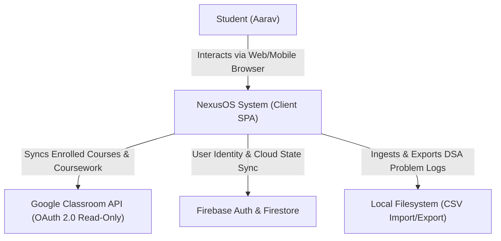
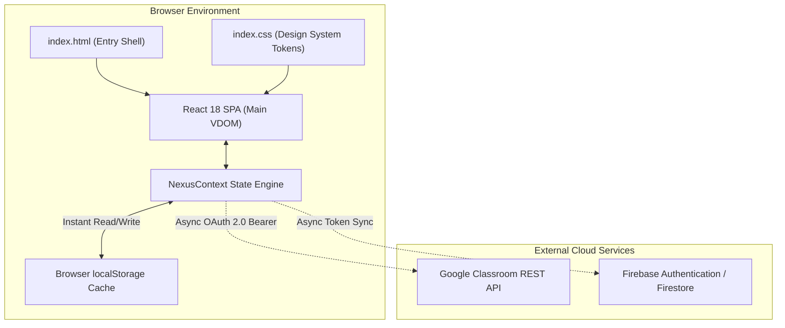
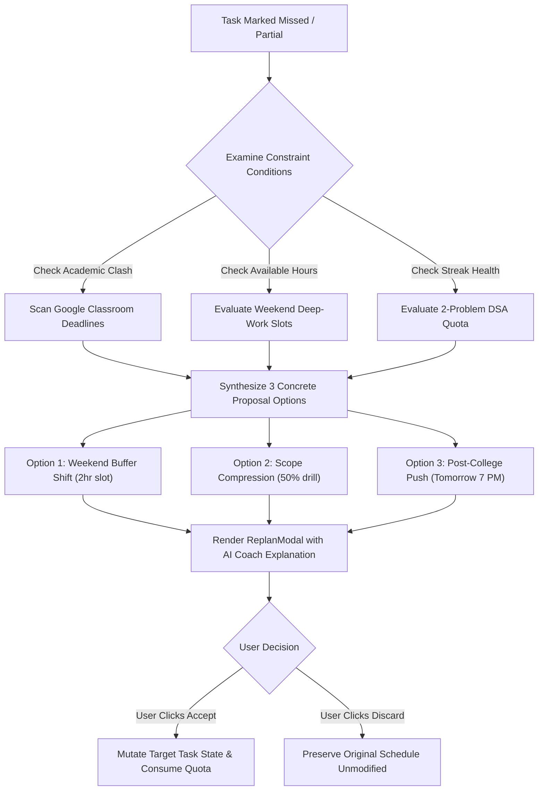
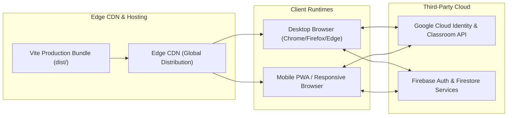

# NexusOS — System Architecture Specification (SAD)
**Document Version:** 1.0.0  
**Target Release:** Production Spec v0.1  
**Architecture Pattern:** Layered Client-Centric Reactive SPA + Offline-First Local Cache + Cloud Synchronization  
**Core Technologies:** React 18, Vite 6, Context API, Lucide Icons, Canvas Confetti, Firebase 11  

---

## 1. Architectural Overview & Design Philosophy

NexusOS is built as a high-performance, responsive **Single-Page Application (SPA)** with an **Offline-First Domain Engine**. Unlike server-heavy tools that introduce latency on every task check-off, NexusOS executes all daily scheduling calculations, conflict detections, and streak calculations client-side in sub-10ms timeframes.

### 1.1 Core Architectural Principles
1. **Zero-Latency Interactions (Optimistic UI):** State mutations (task completions, daily check-ins, DSA logging) update UI instantly with rollback capability.
2. **Deterministic Over Black-Box:** The Adaptive Replanning Engine relies on deterministic heuristics and constraint solving rather than non-deterministic LLM calls for schedule generation, ensuring zero hallucinated times or destroyed milestones.
3. **Data Sovereignty & Offline Resilience:** All state persists to `localStorage` instantaneously and synchronizes asynchronously with Firebase when credentials are present.
4. **Modular Boundary Decoupling:** Domain logic (Replanning, DSA Tracking, Classroom Sync) is encapsulated in pure dispatchers inside `NexusContext.jsx`, separate from presentation components.

---

## 2. C4 Architecture Models

### 2.1 Level 1: System Context Diagram



### 2.2 Level 2: Container Diagram



### 2.3 Level 3: Component Decomposition

```mermaid
graph LR
    subgraph UI Presentation Layer
        Nav["Navbar.jsx"]
        Cmd["CommandPalette.jsx"]
        Daily["DailyPlanView.jsx"]
        Goals["GoalsView.jsx"]
        Classroom["ClassroomView.jsx"]
        DSA["DSATrackerView.jsx"]
        Report["WeeklyReportView.jsx"]
        PRD["PRDAnalysisView.jsx"]
        Settings["SettingsView.jsx"]
        Landing["LandingPageView.jsx"]
    end

    subgraph Modal Layer
        MReplan["ReplanModal.jsx"]
        MTask["AddTaskModal.jsx"]
        MGoal["AddGoalModal.jsx"]
        MDSA["LogDSAModal.jsx"]
        MCSV["CSVImportModal.jsx"]
        MUpgrade["UpgradeModal.jsx"]
        MAuth["AuthModal.jsx"]
    end

    subgraph Domain Engine Layer (NexusContext.jsx)
        TaskEng["Task & Check-in Dispatcher"]
        ReplanEng["Deterministic Replan Engine"]
        ClassroomEng["Classroom Sync & Turn-In Linker"]
        DSAEng["DSA Quota & Topic Matrix Aggregator"]
        StreakEng["Consistency Streak & Spaced Repetition"]
        ToastEng["Feedback & Toast Dispatcher"]
    end

    Nav --> NexusCtx
    Daily --> NexusCtx
    Goals --> NexusCtx
    Classroom --> NexusCtx
    DSA --> NexusCtx
    Report --> NexusCtx
    PRD --> NexusCtx
    Settings --> NexusCtx
    Landing --> NexusCtx

    MReplan --> ReplanEng
    MTask --> TaskEng
    MGoal --> TaskEng
    MDSA --> DSAEng
    MCSV --> DSAEng
    MAuth --> NexusCtx
```

---

## 3. Subsystem Deep-Dive

### 3.1 Subsystem A: Deterministic Adaptive Replanning Engine
The replanner resolves scheduling conflicts when tasks are marked `missed` or `partial`. It implements a three-tier heuristic algorithm:



#### Deterministic Heuristic Specifications
- **Option 1 (Buffer Shift):** Identifies nearest Saturday/Sunday 09:30 AM block. Reallocates task estimated duration without shifting target milestone deadlines.
- **Option 2 (Scope Compression):** Reduces `estMinutes` by $50\%$ (`Math.round(task.estMinutes / 2)`). Flags task with `[Compressed]` prefix to maintain daily consistency streak with minimal cognitive fatigue.
- **Option 3 (Evening Reschedule):** Identifies post-class buffer (07:00 PM next day). Keeps completion inside the current weekly sprint cycle.
- **Strict Invariant:** No schedule modification occurs without explicit student confirmation (`applyReplanOption(option)`).

### 3.2 Subsystem B: Google Classroom Harmonization Engine
- **OAuth 2.0 Ingestion:** Initiates pop-up OAuth flow requesting read-only permissions (`https://www.googleapis.com/auth/classroom.courses.readonly`, `https://www.googleapis.com/auth/classroom.coursework.me.readonly`).
- **Coursework Deduplication Key:** Each ingested assignment is keyed by `id` and tagged with `source: 'classroom'`.
- **Bidirectional Task Linkage:** When a daily task possesses an `externalId` matching a Classroom coursework record, calling `completeTask(taskId)` automatically triggers a reciprocal state mutation marking the coursework item as `status: 'turned_in'`.

### 3.3 Subsystem C: DSA Mastery & Streak Preservation Engine
- **Taxonomy Structure:** Tracks 6 canonical categories: *Arrays & Strings*, *Two Pointers & Sliding Window*, *Trees & BST*, *Graphs*, *Dynamic Programming*, and *Trie & Bits*.
- **Daily Quota Logic:** Evaluates total problems solved on `currentDate`. If $\ge 2$, streak status flags `quotaSatisfied: true`.
- **Difficulty Balance:** Computes dynamic percentage breakdown ($E\% : M\% : H\%$). Displays optimal placement recommendation warning if Medium representation falls below $50\%$.

### 3.4 Subsystem D: Sunday AI Coach Analytics Aggregator
- **Trend Analyzer:** Aggregates executed minutes across Monday through Sunday. Converts minutes into focus hours ($h = \frac{m}{60}$).
- **Completion Velocity:** Formulates percentage completion:
  $$\text{Velocity} = \left(\frac{\text{Executed Tasks}}{\text{Planned Tasks}}\right) \times 100$$
- **Synthesis Engine:** Evaluates velocity against student baseline to generate praise or burnout warnings.

---

## 4. State Management & Data Schema

The root state store is managed by `NexusProvider` inside [NexusContext.jsx](file:///c:/Users/Asus/OneDrive/NexusOS/src/context/NexusContext.jsx).

```typescript
interface NexusOSState {
  user: {
    name: string;
    email: string;
    college: string;
    branch: string;
    year: string;
    targetDate: string;
    streakDays: number;
    plan: 'Free' | 'Placement Pro';
    replansUsedThisMonth: number;
    replansLimit: number;
    preferredLanguage: 'hinglish' | 'english';
  };
  stats: {
    streakDays: number;
    tasksDone: number;
    totalTasks: number;
    focusHoursPlanned: number;
    focusHoursCompleted: number;
    classroomPending: number;
  };
  tasks: Array<{
    id: string;
    title: string;
    category: 'dsa' | 'academic' | 'project' | 'skill';
    estMinutes: number;
    dueTime: string;
    status: 'pending' | 'done' | 'partial' | 'missed';
    source: 'manual' | 'goal' | 'classroom';
    notes?: string;
    externalId?: string;
  }>;
  goals: Array<{
    id: string;
    title: string;
    category: string;
    targetDate: string;
    weeklyHours: number;
    milestones: Array<{
      id: string;
      title: string;
      phase: string;
      completed: boolean;
    }>;
  }>;
  classroom: {
    connected: boolean;
    accountEmail: string;
    lastSynced: string;
    courses: Array<{
      id: string;
      name: string;
      code: string;
      instructor: string;
      room: string;
    }>;
    assignments: Array<{
      id: string;
      courseCode: string;
      courseName: string;
      title: string;
      description: string;
      dueDate: string;
      status: 'assigned' | 'turned_in';
      linkedTaskId?: string;
    }>;
  };
  dsa: {
    target: number;
    totalSolved: number;
    dailyTarget: number;
    solvedToday: number;
    difficulty: {
      easy: number;
      medium: number;
      hard: number;
    };
    topics: Array<{
      id: string;
      name: string;
      solved: number;
      total: number;
    }>;
    recentSolved: Array<{
      id: string;
      title: string;
      platform: string;
      difficulty: 'Easy' | 'Medium' | 'Hard';
      topic: string;
      solvedDate: string;
      timeSpentMinutes: number;
      link?: string;
    }>;
  };
  weeklyReport: {
    weekRange: string;
    completionRate: number;
    tasksDone: number;
    tasksPlanned: number;
    tasksReplanned: number;
    dsaSolved: number;
    totalHoursLogged: number;
    dailyHours: Array<{
      day: string;
      date: string;
      hours: number;
      tasksCompleted: number;
    }>;
    coachDebrief: string;
    highlights: string[];
    missedAreas: string[];
    nextWeekSuggestions: string[];
  };
}
```

---

## 5. Security & Privacy Architecture

```mermaid
graph TD
    Client[NexusOS Client Browser]
    OAuthGateway[Google Identity Platform]
    ClassroomAPI[Google Classroom REST API]
    FirestoreDB[Firebase Firestore (Optional)]

    Client -->|1. Requests Read-Only Auth Token| OAuthGateway
    OAuthGateway -->|2. Emits Scoped JWT Bearer| Client
    Client -->|3. Passes Token in Authorization Header| ClassroomAPI
    ClassroomAPI -->|4. Ingests Raw Submissions & Deadlines| Client
    Client -->|5. Sanitizes & Stores Locally| Client
    Client -.->|6. Syncs Encrypted Profile Metadata| FirestoreDB
```

1. **Principle of Least Privilege:** Classroom integration explicitly restricts scopes to read-only (`classroom.courses.readonly`, `classroom.coursework.me.readonly`). No administrative, modification, or grading scopes are requested.
2. **Zero Code Scraping:** LeetCode and project solutions remain local to the student's device. No user code is ingested into model training pipelines.
3. **Authentication Boundary:** Firebase Auth manages user session tokens. Unauthenticated users run completely in guest mode utilizing local storage persistence without network leakage.

---

## 6. Performance Budget & Optimizations

- **Vite Build Tree-Shaking:** Uses Rollup dynamic chunking and ESModule imports to produce a light footprint:
  - `dist/index.html`: `1.33 kB` (`0.71 kB` gzip)
  - `dist/assets/index.css`: `12.67 kB` (`3.42 kB` gzip)
  - `dist/assets/index.js`: `537.72 kB` (`130.41 kB` gzip)
- **Fluid Micro-Animations:** Numbers and streak indicators interpolate values through the browser's native `requestAnimationFrame` loop in [useAnimatedCounter.js](file:///c:/Users/Asus/OneDrive/NexusOS/src/hooks/useAnimatedCounter.js) without triggering excessive React render cycles.
- **Zero Third-Party Tracking Bloat:** Lightweight canvas confetti and custom SVGs replace heavy third-party UI component libraries.

---

## 7. Deployment & Infrastructure Topology



- **Static Asset Serving:** Build artifacts in `dist/` can be served directly from any global CDN (Vercel, Firebase Hosting, Cloudflare Pages, or AWS S3 + CloudFront).
- **Environment Variables:**
  - `VITE_FIREBASE_API_KEY`, `VITE_FIREBASE_AUTH_DOMAIN`, `VITE_FIREBASE_PROJECT_ID`
  - `VITE_GOOGLE_CLASSROOM_CLIENT_ID`
- **Graceful Degradation:** If environment variables are absent, NexusOS operates fully in standalone demonstration mode with local storage persistence.

---

*Authored and Approved for NexusOS Engineering Architecture Standards.*
