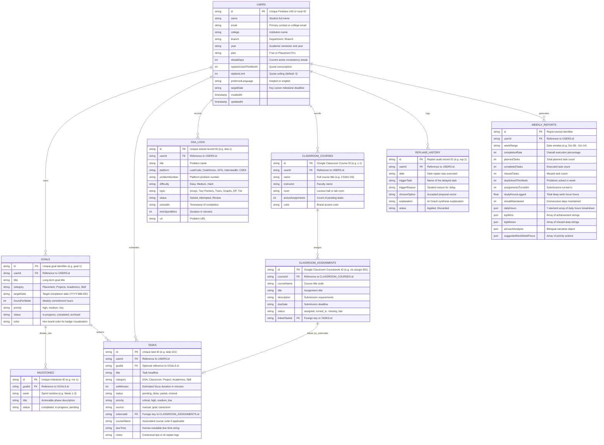

# NexusOS — Database Architecture & Data Dictionary
**Document Version:** 1.0.0  
**Target Release:** Production Spec v0.1  
**Database Model:** Hybrid Dual-Tier (Offline-First LocalStorage Key-Value Store + Cloud Firestore Document Database)  
**Schema Standard:** Strongly-Typed JSON Document Specification with Relational Foreign-Key Mapping  

---

## 1. Database Architecture & Persistence Strategy

NexusOS employs a **Dual-Tier Offline-First Persistence Architecture**. This model provides immediate, sub-millisecond local read/writes for student workflows, while synchronizing with Cloud Firestore when network connectivity and Firebase credentials are authenticated.

```mermaid
graph TD
    subgraph Client-Side Storage Tier
        LS["localStorage (nexus_os_data)"]
        LU["localStorage (nexus_os_firebase_user)"]
        CSV["CSV Ingestion / Export Buffer"]
    end

    subgraph State Engine (NexusContext.jsx)
        Memory["In-Memory State (React Virtual DOM)"]
        Dispatch["Action Dispatchers (Optimistic UI)"]
    end

    subgraph Cloud Storage Tier (Firebase / Firestore)
        FSUsers["/users/{userId}"]
        FSGoals["/users/{userId}/goals"]
        FSTasks["/users/{userId}/tasks"]
        FSClassroom["/users/{userId}/classroom"]
        FSDSA["/users/{userId}/dsa_logs"]
        FSReplans["/users/{userId}/replans"]
    end

    Dispatch --> Memory
    Memory <-->|"Synchronous Serialization (JSON)"| LS
    Memory <-->|"Auth Token Cache"| LU
    Dispatch <-->|"Import / Export"| CSV
    Memory -.->|"Asynchronous Cloud Sync (TLS 1.3)"| FSUsers
    Memory -.->|"Async Subcollection Sync"| FSGoals
    Memory -.->|"Async Subcollection Sync"| FSTasks
    Memory -.->|"Async Subcollection Sync"| FSClassroom
    Memory -.->|"Async Subcollection Sync"| FSDSA
    Memory -.->|"Async Subcollection Sync"| FSReplans
```

### Persistence Guarantees
1. **Local-First Zero-Latency:** All create, update, and delete (CUD) operations write to the in-memory React state and immediately serialize to `localStorage` under the key `nexus_os_data`.
2. **Fault Tolerance & Graceful Fallback:** If local storage is cleared or unavailable, the system automatically hydrates with rich default seeds from `src/data/initialData.js`.
3. **Asynchronous Cloud Sync:** When `isFirebaseConfigured()` evaluates to true, user sessions authenticate through Firebase Auth, syncing state changes to a normalized collection tree in Firestore.

---

## 2. Entity-Relationship Diagram (ERD)



---

## 3. Detailed Data Dictionary

### 3.1 Collection: `users`
Primary profile, authentication metadata, and subscription quotas.

| Field Name | Type | Constraints | Description |
|---|---|---|---|
| `id` | `String` | Primary Key, Not Null | Unique identifier (Firebase UID or `"user-local"`) |
| `name` | `String` | Not Null | Student's display name (e.g. `"Aarav Sharma"`) |
| `email` | `String` | Unique, Index | Student contact email or college ID |
| `college` | `String` | Not Null | University or institute name |
| `branch` | `String` | Default: `""` | Degree program (e.g. `"Computer Science & Engineering"`) |
| `year` | `String` | Default: `""` | Semester/year (e.g. `"3rd Year (Sem 5)"`) |
| `plan` | `Enum` | `'Free'`, `'Placement Pro'` | Current subscription tier |
| `streakDays` | `Integer` | $\ge 0$, Default: `0` | Active streak count in consecutive days |
| `replansUsedThisMonth` | `Integer` | $\ge 0$, Default: `0` | Replans consumed in current monthly billing cycle |
| `replansLimit` | `Integer` | Default: `5` | Free quota ceiling; ignored if `plan === 'Placement Pro'` |
| `preferredLanguage` | `Enum` | `'hinglish'`, `'english'` | Localization token for UI copy and AI debriefs |
| `targetDate` | `DateString` | Format: `YYYY-MM-DD` | Key milestone target (e.g. `"2027-01-15"`) |

---

### 3.2 Collection: `goals`
Multi-week roadmaps broken into structured sequential phases.

| Field Name | Type | Constraints | Description |
|---|---|---|---|
| `id` | `String` | Primary Key, Not Null | Unique identifier (e.g. `"goal-1"`) |
| `userId` | `String` | Foreign Key $\rightarrow$ `users.id` | Owner student reference |
| `title` | `String` | Not Null | Goal headline (e.g. `"Crack Top-Tier SDE Internship"`) |
| `category` | `Enum` | `'Placement'`, `'Projects'`, `'Academics'`, `'Skill'` | Goal classification |
| `targetDate` | `DateString` | Format: `YYYY-MM-DD` | Target deadline |
| `hoursPerWeek` | `Integer` | $1 \le x \le 80$ | Weekly allocated study hours |
| `priority` | `Enum` | `'critical'`, `'high'`, `'medium'`, `'low'` | Urgency weighting |
| `status` | `Enum` | `'in-progress'`, `'completed'`, `'archived'` | Lifecycle state |
| `color` | `String` | Format: `#RRGGBB` | Hex color code for UI cards and badges |

---

### 3.3 Embedded Collection: `goals.milestones`
Sequential phases belonging to a parent goal.

| Field Name | Type | Constraints | Description |
|---|---|---|---|
| `id` | `String` | Primary Key, Not Null | Unique milestone ID (e.g. `"m1-1"`) |
| `goalId` | `String` | Foreign Key $\rightarrow$ `goals.id` | Parent goal reference |
| `week` | `String` | Not Null | Sprint window (e.g. `"Week 1-3"`, `"Week 4-6"`) |
| `title` | `String` | Not Null | Phase scope (e.g. `"Master Arrays & Binary Search"`) |
| `status` | `Enum` | `'completed'`, `'in-progress'`, `'pending'` | Sprint state |

---

### 3.4 Collection: `tasks`
Atomic daily study items, lab submissions, and practice sessions.

| Field Name | Type | Constraints | Description |
|---|---|---|---|
| `id` | `String` | Primary Key, Not Null | Unique task ID (e.g. `"task-101"`) |
| `userId` | `String` | Foreign Key $\rightarrow$ `users.id` | Owner student reference |
| `goalId` | `String` | Foreign Key $\rightarrow$ `goals.id` (Nullable) | Associated roadmap goal |
| `title` | `String` | Not Null | Actionable headline |
| `category` | `Enum` | `'DSA'`, `'Classroom'`, `'Project'`, `'Academics'`, `'Skill'` | Classification |
| `estMinutes` | `Integer` | $5 \le x \le 360$ | Estimated focus duration in minutes |
| `status` | `Enum` | `'pending'`, `'done'`, `'partial'`, `'missed'` | Daily execution status |
| `priority` | `Enum` | `'critical'`, `'high'`, `'medium'`, `'low'` | Execution precedence |
| `source` | `Enum` | `'manual'`, `'goal'`, `'classroom'` | Provenance source |
| `externalId` | `String` | Foreign Key $\rightarrow$ `classroom.assignments.id` | Cross-reference to Classroom coursework |
| `courseName` | `String` | Optional | Name of associated university course |
| `dueTime` | `String` | Not Null | Scheduled time or deadline string |
| `notes` | `String` | Optional | Contextual tips, study links, or replan history |

---

### 3.5 Collection: `dsa_logs`
Granular problem log repository for placement preparation tracking.

| Field Name | Type | Constraints | Description |
|---|---|---|---|
| `id` | `String` | Primary Key, Not Null | Problem log ID (e.g. `"dsa-1"`) |
| `userId` | `String` | Foreign Key $\rightarrow$ `users.id` | Owner student reference |
| `title` | `String` | Not Null | Problem name (e.g. `"Lowest Common Ancestor"`) |
| `platform` | `Enum` | `'LeetCode'`, `'Codeforces'`, `'GeeksforGeeks'`, `'InterviewBit'`, `'CSES'` | Coding platform |
| `problemNumber`| `String` | Optional | Platform problem number (e.g. `"236"`) |
| `difficulty` | `Enum` | `'Easy'`, `'Medium'`, `'Hard'` | Standard difficulty rating |
| `topic` | `Enum` | Canonical topic taxonomy | DSA topic category |
| `status` | `Enum` | `'Solved'`, `'Attempted'`, `'Review'` | Resolution status |
| `solvedAt` | `String` | Not Null | Date and time solved |
| `timeSpentMins`| `Integer`| $1 \le x \le 240$ | Focus duration spent solving |
| `url` | `String` | Optional, URL Format | Web link to the problem |

---

### 3.6 Collection: `classroom`
University enrolled courses and synced coursework submissions.

#### `classroom.courses`
| Field Name | Type | Constraints | Description |
|---|---|---|---|
| `id` | `String` | Primary Key | Google Classroom course ID (e.g. `"c-1"`) |
| `name` | `String` | Not Null | Course title (e.g. `"CS301: Operating Systems"`) |
| `instructor` | `String` | Not Null | Faculty / Professor name |
| `room` | `String` | Optional | Lecture hall or lab number |
| `activeAssignments` | `Integer` | $\ge 0$ | Count of unsubmitted assignments |
| `color` | `String` | Hex format | Card accent color |

#### `classroom.assignments`
| Field Name | Type | Constraints | Description |
|---|---|---|---|
| `id` | `String` | Primary Key | Google Classroom coursework ID (e.g. `"cls-assign-301"`) |
| `courseId` | `String` | Foreign Key $\rightarrow$ `courses.id` | Enrolled course reference |
| `courseName` | `String` | Not Null | Course title string |
| `title` | `String` | Not Null | Coursework title |
| `description` | `String` | Optional | Instructions and problem statements |
| `dueDate` | `String` | Not Null | University submission deadline |
| `status` | `Enum` | `'assigned'`, `'turned_in'`, `'missing'`, `'late'` | University submission state |
| `linkedTaskId` | `String` | Foreign Key $\rightarrow$ `tasks.id` | Cross-reference to daily task |

---

### 3.7 Collection: `replans_history`
Audit ledger of scheduling conflicts and accepted AI adaptations.

| Field Name | Type | Constraints | Description |
|---|---|---|---|
| `id` | `String` | Primary Key | Replan transaction ID (e.g. `"rep-1"`) |
| `userId` | `String` | Foreign Key $\rightarrow$ `users.id` | Student reference |
| `date` | `String` | Not Null | Execution date |
| `triggerTask` | `String` | Not Null | Name of the delayed task |
| `triggerReason` | `String` | Not Null | Reason for delay (e.g. academic clash) |
| `chosenOption` | `String` | Not Null | Accepted proposal summary |
| `explanation` | `String` | Not Null | AI Coach heuristic rationale |
| `status` | `Enum` | `'Applied'`, `'Discarded'` | Resolution state |

---

## 4. Integrity Invariants & Business Rules

1. **Task-Coursework Synchronous Completion Rule:**
   - When a daily task with an `externalId` is toggled to `status === 'done'`, the engine MUST execute a cascading update to the corresponding `classroom.assignments` item setting `status = 'turned_in'`.
2. **Quota Invariant (Free Tier Limitation):**
   - If `users.plan === 'Free'`, the engine restricts `users.replansUsedThisMonth \le users.replansLimit (5)`. Attempting a 6th replan prompts the user with the `UpgradeModal`.
3. **Streak Continuity Invariant:**
   - A streak day increment is awarded if either:
     - At least 1 daily task is marked `done`, OR
     - `dsa.solvedToday \ge 1`.
   - The daily quota is satisfied when `dsa.solvedToday \ge 2`.
4. **Non-Intrusive Replanning Invariant:**
   - Under no circumstances does the engine mutate a task's `dueTime` or `estMinutes` without the student explicitly clicking an `Accept` button on the proposal.

---

## 5. Security Rules Specification (`firestore.rules`)

When deploying to Google Cloud Firestore, the following security rules enforce strict tenant isolation and read-only protection:

```javascript
rules_version = '2';
service cloud.firestore {
  match /databases/{database}/documents {
    
    // Helper function: verifies authenticated user is the owner
    function isOwner(userId) {
      return request.auth != null && request.auth.uid == userId;
    }

    // User profile access
    match /users/{userId} {
      allow read, write: if isOwner(userId);

      // Subcollections scoped to owner
      match /tasks/{taskId} {
        allow read, write: if isOwner(userId);
      }

      match /goals/{goalId} {
        allow read, write: if isOwner(userId);
      }

      match /dsa_logs/{logId} {
        allow read, write: if isOwner(userId);
      }

      match /classroom/{docId} {
        allow read, write: if isOwner(userId);
      }

      match /replans/{replanId} {
        allow read, write: if isOwner(userId);
      }
    }
  }
}
```

---

## 6. CSV Bulk Import/Export Schema

To support interoperability with LeetCode submissions and Striver sheets, the engine supports a standard comma-separated format:

```csv
Problem Title,Platform,Difficulty,Topic,Time Minutes,Date Solved,Problem URL
"Binary Tree Maximum Path Sum","LeetCode","Hard","Trees & BST",35,"2026-10-18","https://leetcode.com/problems/binary-tree-maximum-path-sum/"
"Course Schedule II","LeetCode","Medium","Graphs",28,"2026-10-17","https://leetcode.com/problems/course-schedule-ii/"
"Trapping Rain Water","LeetCode","Hard","Two Pointers",45,"2026-10-16","https://leetcode.com/problems/trapping-rain-water/"
```

### Parsing Pipeline
1. Validates CSV header format.
2. Sanitizes problem title and URLs.
3. Automatically maps topic strings to the canonical 6-topic taxonomy.
4. Updates in-memory DSA count and difficulty meters without requiring server interaction.

---

*Authored for NexusOS Database Architecture & Engineering Standards.*
