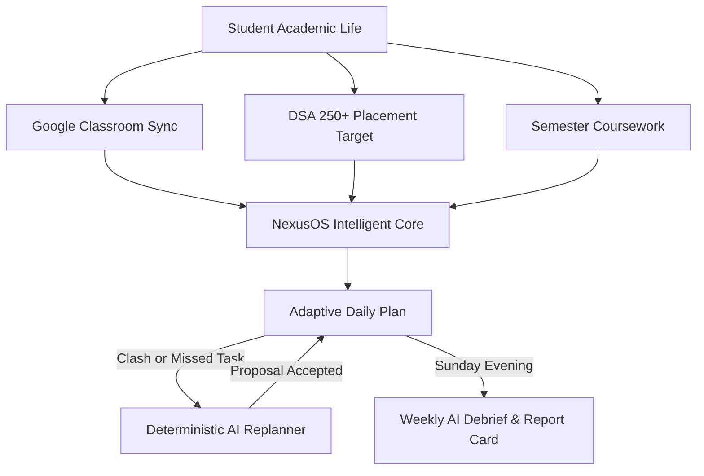
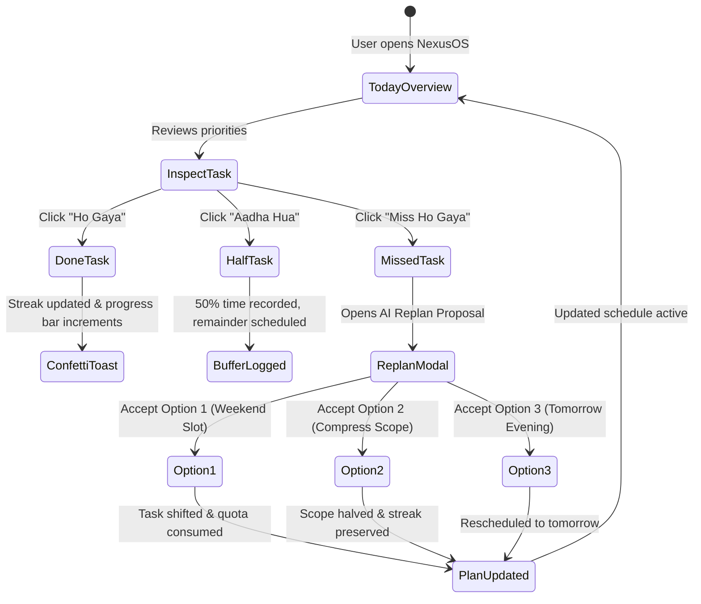
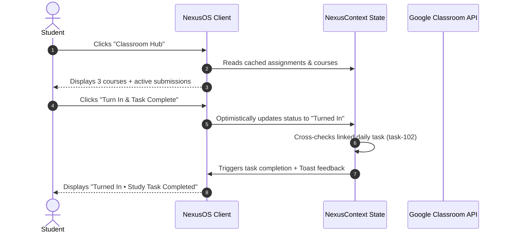

# NexusOS — Design & UI/UX Specification Document
**Version:** 1.0.0  
**Target Platform:** Web Desktop & Mobile Responsive  
**Design Paradigm:** *Productive Serenity* — Modern Clean White + Fresh Emerald/Forest Green SaaS System  
**Primary Typography:** Plus Jakarta Sans & JetBrains Mono  

---

## 1. Executive Summary & Product Vision

**NexusOS** is an intelligent student operating system engineered specifically for Indian engineering and computer science undergraduates. Unlike generic productivity apps (Notion, Todoist, Google Tasks), NexusOS addresses the acute fragmentation students face: balancing university semester coursework, Google Classroom deadlines, DSA interview preparation, and unpredictable academic schedules.

### Core UX Tenets
1. **Guilt-Free Adaptive Planning:** When a submission or exam derails a student's day, NexusOS does not punish them with red overdue badges. Instead, the AI Replanner recalculates feasible pathways across weekend buffer slots.
2. **The 15-Second Daily Check-in:** The daily loop requires minimal friction: three quick-action check-in chips (*"Ho Gaya"*, *"Aadha Hua"*, *"Miss Ho Gaya"*).
3. **Contextual Academic Resonance:** Dual language capability (Hinglish 🇮🇳 / English 🌐) provides relatable, empathetic coaching (*"Aaj raat OS lab due hai, isliye DSA evening session buffer mein shift kiya"*).
4. **Day-1 Instant Utility:** Read-only Google Classroom integration pulls active coursework automatically without manual data-entry burnout.



---

## 2. Design Philosophy: *Productive Serenity*

Typical developer tools gravitate toward high-contrast dark modes or cluttered dashboards. NexusOS adopts **Productive Serenity**:
- **Palette Foundation:** Crisp clinical whites (`#FFFFFF`), whisper-soft mint surfaces (`#F8FAF8`, `#F0F7F1`), and organic forest green accents (`#15803D`, `#22A06B`).
- **Visual Restraint:** Information is grouped in clean **Bento-style widgets** with subtle borders (`#E3EAE4`) rather than harsh dividers or distracting gradients.
- **Micro-Delight:** Purposeful haptic animations—smooth number counters, soft badge glows, and celebratory confetti upon task completion—reinforce dopamine loops without clutter.

---

## 3. Color Tokens & Semantic Architecture

The design system utilizes CSS custom variables scoped under `:root`, providing consistent contrast ratios compliant with **WCAG 2.1 AA** (minimum 4.5:1 for body text).

### 3.1 Surface & Neutral Tokens
| Token | Hex / Value | Role & Usage |
|---|---|---|
| `--bg-primary` | `#F8FAF8` | Canvas background, soft off-white with mint undertone |
| `--bg-secondary` | `#F0F7F1` | Secondary container fill, input backgrounds, subtle cards |
| `--bg-tertiary` | `#EAF8EE` | Highlighted cards, active states, chip fills |
| `--bg-elevated` | `#FFFFFF` | Card surfaces, modals, popovers, dropdown menus |
| `--border-subtle` | `#E3EAE4` | Standard 1px card boundaries, table dividers |
| `--border-hover` | `#C5D8C8` | Interactive element hover border |
| `--border-focus` | `#22A06B` | Focus ring outline for accessible keyboard navigation |

### 3.2 Typography Neutrals
| Token | Hex | Target Contrast vs `#FFFFFF` | Role |
|---|---|:---:|---|
| `--text-main` | `#17211B` | **15.2 : 1** (AAA) | Primary headings, titles, high-emphasis text |
| `--text-secondary` | `#647067` | **5.3 : 1** (AA) | Body copy, secondary descriptions, metadata |
| `--text-muted` | `#59655D` | **6.4 : 1** (AA) | Timestamps, icon labels, subtle captions |
| `--text-dim` | `#738077` | **4.6 : 1** (AA) | Disabled states, placeholder copy |

### 3.3 Semantic Accent Tokens
| Accent Name | Primary Hex | Glow / Tint Token | Usage |
|---|---|---|---|
| **Forest Green (Brand)** | `#15803D` | `rgba(21, 128, 61, 0.2)` | Primary CTA, active nav tabs, completed tasks |
| **Emerald Green** | `#22A06B` | `rgba(34, 160, 107, 0.25)` | Brand logo badge, progress bars, streaks |
| **Amber Gold** | `#B45309` | `rgba(180, 83, 9, 0.2)` | Streak flame, warnings, Pro tier badges |
| **Rose Alert** | `#DC2626` | `rgba(220, 38, 38, 0.2)` | Hard deadlines (<24h), missed tasks, errors |

---

## 4. Typographic Hierarchy

NexusOS pairs **Plus Jakarta Sans** (humanist geometry for approachable reading) with **JetBrains Mono** (monospaced metrics for times, code tags, and mathematical quotas).

```
Display 1 (32px)   ──> Good morning, Aarav.
  Heading 2 (24px) ──> Today's Focus Tasks
    Subhead (18px) ──> Operating Systems Assignment 3
      Body (16px)  ──> Focus on recursive bottom-up approach...
        Meta (14px)──> Due: Tomorrow 11:59 PM • CS301
          Tag (12px) ──> LeetCode Medium [JETBRAINS MONO]
```

### Typographic Scale Matrix
| Scale Token | Font Family | Size | Weight | Line Height | Usage |
|---|---|:---:|:---:|:---:|---|
| `--text-3xl` | Plus Jakarta Sans | 2.00rem (32px) | 800 | 1.20 | Primary Page Hero Title |
| `--text-2xl` | Plus Jakarta Sans | 1.50rem (24px) | 700 | 1.25 | Metrics figures, section hero heads |
| `--text-xl` | Plus Jakarta Sans | 1.25rem (20px) | 700 | 1.30 | Widget headers, modal titles |
| `--text-lg` | Plus Jakarta Sans | 1.125rem (18px)| 600 | 1.40 | Task card titles, sub-headers |
| `--text-base` | Plus Jakarta Sans | 1.00rem (16px) | 400 / 500 | 1.55 | Standard body descriptions |
| `--text-sm` | Plus Jakarta Sans | 0.875rem (14px)| 500 / 600 | 1.45 | Buttons, input fields, labels |
| `--text-xs` | JetBrains Mono / Sans | 0.75rem (12px) | 600 | 1.40 | Badges, tags, countdown timers |

---

## 5. Geometry, Radius & Elevation

To prevent visual disharmony, NexusOS strictly adheres to **4 radius scales**:

```css
--radius-sm: 8px;       /* Buttons, input fields, pills, search bars */
--radius-md: 14px;      /* Content cards, Bento widgets, dropdown menus */
--radius-lg: 20px;      /* Modals, central hero panels */
--radius-full: 9999px;  /* Avatar circles, pill status tags */
```

### Elevation & Depth Shadows
1. **Subtle Surface (`--shadow-sm`):** `0 1px 3px rgba(23, 33, 27, 0.05)` — Interactive buttons, chip toggles.
2. **Elevated Card (`--shadow-card`):** `0 4px 20px -2px rgba(23, 33, 27, 0.05)` — Bento cards, task containers.
3. **Hover Lift (`--shadow-card-hover`):** `0 10px 25px -4px rgba(23, 33, 27, 0.08)` — Card hover elevation.
4. **Modal Overlay Backdrop:** `rgba(15, 23, 42, 0.45)` with `backdrop-filter: blur(8px)`.

---

## 6. Core Component Specifications

### 6.1 Top Navigation Bar (`Navbar.jsx`)
- **Container:** Fixed sticky header at `top: 0`, height `64px`, `background: rgba(255, 255, 255, 0.94)`, `backdrop-filter: blur(20px)`.
- **Branding:** Logo icon box with 135° emerald gradient (`#22A06B` $\rightarrow$ `#16A34A`), `NexusOS` wordmark, and `Student OS` badge.
- **Tab Switcher:** Pill-shaped navigation items with active emerald indicators (`#EAF8EE` fill + `#166534` text).
- **Global Actions:**
  - `Cmd+K` Quick Search bar trigger.
  - Quick Task button (`+ Task Jodo`).
  - Account Profile Pill with integrated streak flame count (`🔥 14`) and dropdown menu.

### 6.2 Bento Metric Cards (`DailyPlanView.jsx`)
Four unified metrics anchoring the top of the command center:
1. **Consistency Streak:** Flame icon, consecutive days counter, streak status flag.
2. **Day Completion:** Percentage progress radial/bar, fraction display (`2 / 4 Tasks Done`).
3. **Planned Focus Time:** Clock icon, total planned hours (`4.3h`), minutes completed today (`95m`).
4. **Classroom Deadlines:** Book icon, pending submissions count, nearest deadline alert (`CS301 OS`).

### 6.3 Focus Task Item & Quick Check-in Chips
Each daily task card accommodates multi-dimensional metadata without visual noise:
- **Left:** Custom circular checkbox button (`Mark as done / Mark incomplete`).
- **Center:** Task title, academic source badge (`Google Classroom`, `DSA Practice`, `Project`), context tip (`💡 Focus on recursive approach`), duration pill, due time.
- **Right:** **Tri-State Daily Check-in Buttons**:
  - `Ho Gaya` (Green active state): Marks task 100% complete.
  - `Aadha Hua` (Amber state): Logs 50% partial progress, leaves remainder for evening buffer.
  - `Miss Ho Gaya (Replan)` (Rose state): Instantly launches AI Replan modal with this task pre-selected.

```
┌────────────────────────────────────────────────────────────────────────────────┐
│ [✓]  LeetCode: Solve 2 Medium Binary Trees                  [DSA Practice] 60m │
│      💡 Focus on recursive bottom-up approach to avoid O(N^2) complexity.      │
│      Due: 11:00 AM                                                             │
│                                                                                │
│      Daily Check-in:  [ Ho Gaya ]   [ Aadha Hua ]   [ Miss Ho Gaya (Replan) ]  │
└────────────────────────────────────────────────────────────────────────────────┘
```

### 6.4 The Adaptive AI Replan Modal (`ReplanModal.jsx`)
Triggered automatically or manually when a clash occurs:
- **Header:** Deterministic schedule engine status with AI Coach synthesis.
- **Problem Statement:** Identifies delayed task and conflicting college events.
- **3 Deterministic Proposals (A/B/C):**
  - **Option 1 (Recommended):** Weekend Deep-Work Slot Shift (protects burnout & milestone date).
  - **Option 2 (Streak Protector):** Scope compression by 50% (maintains 14-day streak).
  - **Option 3 (Evening Catch-up):** Post-college evening push (preserves current week target).
- **User Agency:** Student retains explicit confirmation via `Accept` buttons or `Ignore (Discard)`.

### 6.5 DSA Placement Tracker Matrix (`DSATrackerView.jsx`)
- **Overall Goal Counter:** Circular progress indicator toward 250 curated problems benchmark.
- **Daily Quota Bar:** 2 problems/day target with animated streak protection confirmation.
- **Difficulty Segmented Bar:** Easy (39%), Medium (51%), Hard (9%) proportional visualization.
- **Topic Saturation Grid:** Interactive cards for Arrays, Two Pointers, Trees, Graphs, DP, Trie with percentage meters and direct solved counts.

### 6.6 Command Palette (`CommandPalette.jsx`)
- **Trigger:** Global key listener on `Cmd+K` (Mac) and `Ctrl+K` (Windows/Linux) or top search input.
- **Layout:** Centered modal with glassmorphism backdrop (`backdrop-filter: blur(12px)`).
- **Capabilities:**
  - Instant fuzzy tab switching (*"Aaj Ka Plan"*, *"DSA Tracker"*, *"Classroom Hub"*).
  - One-click shortcuts (*"Naya Task Jodein"*, *"AI Replan Trigger"*, *"Export CSV"*).
  - Full keyboard navigation with `↑`, `↓`, `Enter`, and `Escape`.

---

## 7. UX Interaction Flows & State Architecture

### 7.1 Daily Check-in & Replan State Loop


### 7.2 Google Classroom 2-Way Sync Flow


---

## 8. Accessibility (a11y) & Usability Standards

NexusOS is built to comply with **WCAG 2.1 Level AA** standards:

1. **Color Contrast:** All body copy meets $\ge 4.5:1$ contrast against card backgrounds. Primary headings meet $\ge 7:1$.
2. **Keyboard Trappability:** All modals trap focus upon mounting and release focus back to the triggering element upon `Escape` or modal close.
3. **ARIA Labels & Roles:**
   - Interactive elements without visible text provide explicit `aria-label` tags (e.g. `aria-label="Account menu and settings"`).
   - Dropdown menus declare `aria-haspopup="menu"` and `aria-expanded`.
   - Screen-reader-only utility (`.sr-only`) provides context for status icons and badges.
4. **Reduced Motion:** CSS animation media query respects user system preferences:
   ```css
   @media (prefers-reduced-motion: reduce) {
     *, *::before, *::after {
       animation-duration: 0.01ms !important;
       transition-duration: 0.01ms !important;
     }
   }
   ```

---

## 9. Animation & Motion Design Guidelines

All UI motion is purposeful, unobtrusive, and adheres to cubic-bezier easing curves:

| Motion Token | Timing Curve | Duration | Usage |
|---|---|:---:|---|
| `--ease-out-expo` | `cubic-bezier(0.16, 1, 0.3, 1)` | 220ms | Dropdown reveals, modals, page transitions |
| `--ease-spring` | `cubic-bezier(0.34, 1.4, 0.64, 1)` | 350ms | Toast entry, streak flame pulse, button clicks |
| `--ease-in-out-smooth` | `cubic-bezier(0.4, 0, 0.2, 1)` | 150ms | Color fills, border hover transitions |

### Micro-Interactions
- **Animated Number Ticker:** Counters utilize `useAnimatedCounter` hook with requestAnimationFrame interpolation for smooth numeric transitions on streak days, percentages, and problem counts.
- **Completion Celebration:** Checking off a task fires `canvas-confetti` burst paired with a floating toast notification in the bottom right corner.

---

## 10. Responsive Breakpoint Strategy

NexusOS adapts seamlessly across devices:

| Breakpoint | Width Range | Layout Adaptation |
|---|:---:|---|
| **Desktop Ultra** | $\ge 1440\text{px}$ | Max container centered `1440px`, 4-column Bento grid |
| **Desktop Standard** | $1024\text{px} - 1439\text{px}$ | 3-column Bento layout, full navbar navigation |
| **Tablet** | $768\text{px} - 1023\text{px}$ | 2-column Bento grid, sidebar widgets collapse below tasks |
| **Mobile** | $< 768\text{px}$ | Single column stacked layout, bottom floating navigation, compact task chips |

---

## 11. Design System File Structure

```
c:/Users/Asus/OneDrive/NexusOS/
├── src/
│   ├── index.css                    # Design tokens, variables, utility classes, animations
│   ├── App.jsx                      # App shell, global toasts, modal containers
│   ├── context/
│   │   └── NexusContext.jsx         # Global data store, deterministic replanner, actions
│   ├── components/
│   │   ├── Navbar.jsx               # Header, brand pill, tab switcher, user dropdown
│   │   ├── DailyPlanView.jsx        # Command center, Bento cards, focus tasks, quick check-ins
│   │   ├── GoalsView.jsx            # Roadmaps, milestone progressions, tier limiter
│   │   ├── ClassroomView.jsx        # Google Classroom sync, coursework list, turn-in
│   │   ├── DSATrackerView.jsx       # 250 roadmap, quota bar, topic matrix, problem log
│   │   ├── WeeklyReportView.jsx     # Deep work trend chart, AI debrief, wins & adjustments
│   │   ├── PRDAnalysisView.jsx      # SWOT, persona profiling, architecture breakdowns
│   │   ├── SettingsView.jsx         # Profile form, theme, language, billing quotas
│   │   ├── LandingPageView.jsx      # Public product showcase, pricing grid, interactive tabs
│   │   ├── ui/
│   │   │   └── CommandPalette.jsx   # Ctrl+K modal with fuzzy action dispatcher
│   │   └── modals/
│   │       ├── ReplanModal.jsx      # 3-option AI schedule rebalancer
│   │       ├── AddTaskModal.jsx     # Task creator dialog
│   │       ├── AddGoalModal.jsx     # Milestone roadmap generator
│   │       ├── LogDSAModal.jsx      # Problem logger with platform & topic taxonomy
│   │       ├── CSVImportModal.jsx   # LeetCode / Striver CSV bulk ingestion
│   │       ├── UpgradeModal.jsx     # Placement Pro tier benefits modal
│   │       └── AuthModal.jsx        # Firebase auth & Google login dialog
└── DESIGN_UIUX.md                   # This comprehensive specification document
```

---

*Authored for NexusOS Engineering & Product Design Teams.*
