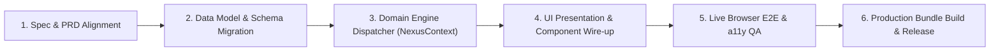
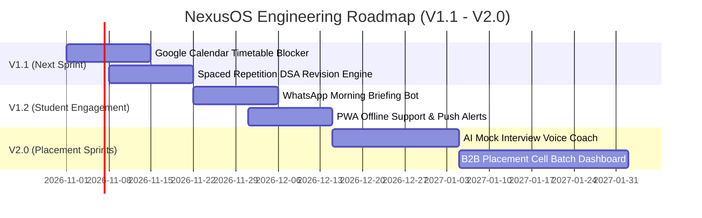

# NexusOS — Feature Development & Engineering Roadmap
**Document Version:** 1.0.0  
**Target Release:** Production Spec v0.1 $\rightarrow$ v2.0  
**Methodology:** Agile Sprint Cadence (2-Week Iterations), Feature-Branch Git Workflow, Definition of Done (DoD) Enforced  

---

## 1. Feature Delivery Framework & Engineering Workflow

To maintain high code quality, zero runtime exceptions, and strict adherence to the *Productive Serenity* design language, all new features follow a standardized 6-stage lifecycle:



### Engineering Principles for Feature Expansion
1. **Design Token Integrity:** Never introduce ad-hoc HEX colors or arbitrary radii. Consume tokens exclusively from `src/index.css` (`var(--accent-primary)`, `var(--radius-sm)`, etc.).
2. **Contextual Dispatcher Decoupling:** State mutations must reside inside [src/context/NexusContext.jsx](file:///c:/Users/Asus/OneDrive/NexusOS/src/context/NexusContext.jsx). UI components must remain clean presentation layers.
3. **Optimistic UI with Fallback:** User actions must render immediately. Network synchronization must occur asynchronously in the background.
4. **Zero-Error Tolerance:** Every feature pull request must pass `npm run build` and display `0` console errors in DevTools.

---

## 2. Feature Inventory: V1.0 Production Baseline

The following core modules are implemented and fully operational in the current release:

| Module / Feature | Component Reference | Domain Dispatcher | Status | Verification Detail |
|---|---|---|:---:|---|
| **Adaptive Daily Command Center** | [DailyPlanView.jsx](file:///c:/Users/Asus/OneDrive/NexusOS/src/components/DailyPlanView.jsx) | `completeTask()`, `markTaskStatus()` | **Production** | 4 Bento metrics, Recommended Next Action banner, tri-state check-in chips (*Ho Gaya*, *Aadha Hua*, *Miss Ho Gaya*). |
| **Deterministic AI Replanner** | [ReplanModal.jsx](file:///c:/Users/Asus/OneDrive/NexusOS/src/components/modals/ReplanModal.jsx) | `generateReplanSuggestions()`, `applyReplanOption()` | **Production** | 3 deterministic proposal vectors with AI Coach explanation; explicit user confirmation flow. |
| **Goals & Milestone Roadmaps** | [GoalsView.jsx](file:///c:/Users/Asus/OneDrive/NexusOS/src/components/GoalsView.jsx) | `addGoal()`, `toggleMilestone()` | **Production** | 4-12 week sprint progressions, weekly hour envelopes, collapsible phase checklists, tier limiter notice. |
| **Google Classroom Hub** | [ClassroomView.jsx](file:///c:/Users/Asus/OneDrive/NexusOS/src/components/ClassroomView.jsx) | `syncClassroom()`, `completeTask()` | **Production** | Read-only OAuth coursework ingestion, enrolled courses cards, 2-way turn-in task linkage. |
| **DSA Placement Tracker** | [DSATrackerView.jsx](file:///c:/Users/Asus/OneDrive/NexusOS/src/components/DSATrackerView.jsx) | `logDSAProblem()`, `importDSACSV()` | **Production** | 250 problem target, 2-problem daily quota meter, difficulty breakdown, 6-topic saturation matrix, CSV import/export. |
| **Sunday Weekly AI Debrief** | [WeeklyReportView.jsx](file:///c:/Users/Asus/OneDrive/NexusOS/src/components/WeeklyReportView.jsx) | Read-only context aggregator | **Production** | 7-day deep work trend bar chart, completion velocity metric, AI Coach synthesis narrative, wins/misses audit. |
| **Global Command Palette** | [CommandPalette.jsx](file:///c:/Users/Asus/OneDrive/NexusOS/src/components/ui/CommandPalette.jsx) | `setActiveTab()`, `setActiveModal()` | **Production** | Global `Cmd/Ctrl+K` key listener, fuzzy action search, full keyboard navigation (`↑`, `↓`, `Enter`, `Esc`). |
| **Settings & Profile Management** | [SettingsView.jsx](file:///c:/Users/Asus/OneDrive/NexusOS/src/components/SettingsView.jsx) | `updateUserProfile()`, `toggleLanguage()` | **Production** | Student academic details, Hinglish/English language toggle, integration controls, local data purge. |
| **SaaS Showcase Landing Page** | [LandingPageView.jsx](file:///c:/Users/Asus/OneDrive/NexusOS/src/components/LandingPageView.jsx) | `setActiveTab()` | **Production** | Public hero section, interactive feature preview tabs, student-budget pricing grid, FAQ, testimonials. |
| **Firebase Auth & Cloud Sync** | [AuthModal.jsx](file:///c:/Users/Asus/OneDrive/NexusOS/src/components/modals/AuthModal.jsx) | `handleFirebaseUserLogin()`, `logoutUser()` | **Production** | Google Sign-In, Email/Password, Anonymous guest mode, live auth state observer, token persistence. |

---

## 3. Short-Term Roadmap: V1.1 – V1.3



### 3.1 Feature 1: Google Calendar 2-Way Sync & Class Timetable Blocker (v1.1)
- **Objective:** Automatically block out college class timetables (e.g. 09:00 AM – 04:00 PM) to prevent the daily planner from scheduling study tasks during lectures.
- **Architectural Specification:**
  - Ingest Google Calendar events via Google Calendar API v3 (`calendar.events.readonly`).
  - Classify events into `lecture`, `lab`, `exam`, and `free_window`.
  - The Adaptive Replan engine automatically slots focus tasks into identified `free_window` blocks.

### 3.2 Feature 2: Spaced Repetition DSA Revision Engine (v1.1)
- **Objective:** Prevent students from forgetting complex data structure patterns solved weeks earlier.
- **Algorithm (SuperMemo SM-2 Variant):**
  - Problems marked `Solved` are assigned an initial review interval:
    $$\text{Interval}_1 = 48\text{ hours}, \quad \text{Interval}_2 = 7\text{ days}, \quad \text{Interval}_3 = 21\text{ days}$$
  - Surfaces a *"Flash Revision Today"* section in the DSA Tracker view with 1–2 rapid pattern reviews.

### 3.3 Feature 3: WhatsApp Morning Briefing & 15-Second Evening Bot (v1.2)
- **Objective:** Meet students where they already live (WhatsApp) to minimize app open friction.
- **Specifications:**
  - **07:30 AM Daily Briefing:** Sends a formatted WhatsApp message with today's 3 focus tasks, nearest Classroom deadline, and daily DSA quota.
  - **09:30 PM Quick Check-in:** Sends 3 interactive buttons (*"Sab Ho Gaya"*, *"Aadha Hua"*, *"Replan Chahiye"*). Clicking auto-updates NexusOS via webhook.

### 3.4 Feature 4: Progressive Web App (PWA) & Native Notifications (v1.2)
- **Objective:** Enable mobile home-screen installation and offline push notifications for critical deadlines.
- **Specifications:**
  - Add `manifest.json` with app icons, standalone display mode, and theme color `#15803D`.
  - Service Worker (`sw.js`) caching core app shell and static assets using Cache API.
  - Web Push API reminders: 30 minutes before classroom assignment deadlines.

---

## 4. Medium-Term Roadmap: V2.0 (Placement Season Sprints)

### 4.1 Feature 5: AI Voice Mock Interview Coach
- **Objective:** Simulate real-world tech interview rounds for Aarav's target placement season.
- **Capabilities:**
  - Interactive coding audio interviews evaluating DSA approach, edge cases, and time complexity.
  - Post-interview score card evaluating communication clarity, optimal time complexity, and code cleanliness.

### 4.2 Feature 6: B2B College Placement Cell (T&P) Cohort Dashboard
- **Objective:** Monetization growth vector selling aggregate batch analytics to college administration.
- **Capabilities:**
  - Placement officers inspect batch-wide topic readiness (e.g. 68% of 3rd Year CSE batch is ready in Graphs & DP).
  - Anonymized benchmarking across engineering colleges.

---

## 5. Technical Implementation Guide: How to Add a Feature

This step-by-step developer guide demonstrates how to build and integrate any new feature into NexusOS:

### Step 1: Extend State Schema in `initialData.js`
Define the initial data schema and fallback state values:
```javascript
// src/data/initialData.js
export const initialData = {
  // ... existing state
  calendarSync: {
    enabled: false,
    timetableBlocks: [],
    lastSynced: null
  }
};
```

### Step 2: Implement Domain Dispatcher in `NexusContext.jsx`
Expose the state mutation logic through the Context Provider:
```javascript
// src/context/NexusContext.jsx
const addTimetableBlock = (block) => {
  setData(prev => ({
    ...prev,
    calendarSync: {
      ...prev.calendarSync,
      timetableBlocks: [...prev.calendarSync.timetableBlocks, block]
    }
  }));
  showToast('Timetable Updated', 'Class hours blocked out of study planner.', 'success');
};
```

### Step 3: Consume in UI Component
Bind the context dispatcher to user actions:
```jsx
// src/components/TimetableView.jsx
import React from 'react';
import { useNexus } from '../context/NexusContext';

export const TimetableView = () => {
  const { data, addTimetableBlock } = useNexus();

  return (
    <div className="glass-panel motionsites-card">
      <h3>Enrolled Class Blocks</h3>
      {/* Component UI */}
    </div>
  );
};
```

### Step 4: Register in App Shell & Command Palette
Add the new view to `App.jsx` and register shortcut commands in `CommandPalette.jsx` for universal keyboard navigation.

---

## 6. Definition of Done (DoD) & QA Checklist

Before any feature branch is merged into `main` or deployed to production, it must fulfill the following **Definition of Done**:

- [ ] **Functional Correctness:** All user acceptance criteria from the feature spec are satisfied.
- [ ] **Design Token Adherence:** All colors, typography, borders, and shadows consume tokens from `index.css`.
- [ ] **Optimistic UI & Feedback:** State mutations update immediately with toast notification and/or celebration animation.
- [ ] **Keyboard Accessibility:** Component is navigable via `Tab`, `Enter`, and dismissible via `Escape`.
- [ ] **WCAG Contrast:** All text meets $\ge 4.5:1$ contrast against surrounding surfaces.
- [ ] **Console Cleanliness:** Zero warnings, uncaught promises, or errors in browser DevTools.
- [ ] **Production Build Validation:** `npm run build` exits with code `0`.

---

*Authored for NexusOS Product Management & Engineering Teams.*
