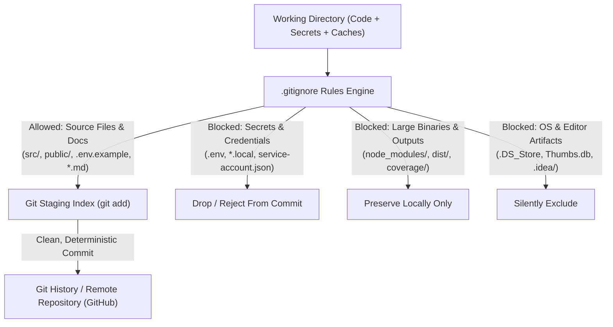

# NexusOS — Version Control Exclusion & Security Hygiene Specification (GITIGNORE.md)
**Document Version:** 1.0.0  
**Target Release:** Production Spec v0.1  
**Target File Reference:** [.gitignore](file:///c:/Users/Asus/OneDrive/NexusOS/.gitignore)  
**Security Standards:** OWASP Source Code Security, Zero-Secret Exposure Guarantee, Git Hygiene Best Practices  

---

## 1. Executive Summary & Security Rationale

A robust, enterprise-grade `.gitignore` is not merely a list of omitted files; it is a **foundational perimeter defense** and an operational requirement for codebase maintainability.

In **NexusOS**, version control hygiene safeguards three non-negotiable engineering mandates:
1. **Zero Secret Leakage:** Prevention of accidental commits containing Firebase API keys, OAuth client secrets, or private university access tokens.
2. **Deterministic Build Reproducibility:** Clean separation of source code from generated machine-specific artifacts (`dist/`, `node_modules/`, `.vite/`).
3. **Repository Slimness & Cloning Speed:** Preventing bloat from binary caches, test video recordings, OS indexing files (`.DS_Store`, `Thumbs.db`), and IDE metadata.



---

## 2. Comprehensive Exclusion Classification Matrix

The [.gitignore](file:///c:/Users/Asus/OneDrive/NexusOS/.gitignore) is divided into 9 functional exclusion domains:

| # | Exclusion Domain | Patterns Specified | Primary Threat / Rationale |
|:---:|---|---|---|
| **1** | **Dependencies** | `node_modules/`, `.pnpm-store/`, `.yarn/cache/`, `.pnp*` | Prevents hundreds of megabytes of third-party external code from polluting git history. |
| **2** | **Production Builds** | `dist/`, `dist-ssr/`, `build/`, `out/`, `*.tsbuildinfo` | Transpiled bundles and minified CSS must be compiled fresh by CI/CD, not checked in. |
| **3** | **Secrets & Env Vars** | `.env`, `.env.*.local`, `*.env.local` *(exception: `!.env.example`)* | Prevents catastrophic credential leaks of Firebase keys and API secrets to public repos. |
| **4** | **Runtime Logs** | `logs/`, `*.log`, `npm-debug.log*`, `yarn-error.log*` | Prevents disk churn and leaking local file system paths from failed installation scripts. |
| **5** | **Testing & Coverage** | `coverage/`, `playwright-report/`, `test-results/` | Test execution reports, raw screenshots, and Istanbul HTML reports change on every run. |
| **6** | **Bundler Caches** | `.vite/`, `.cache/`, `.eslintcache`, `*.tmp`, `*.temp` | Transpilation caches must remain ephemeral to prevent stale development states. |
| **7** | **IDE & Editor Metadata** | `.idea/`, `.vscode/*` *(allow settings/extensions)*, `*.sw?` | Prevents personal workstation window state, cursor history, and workspace files from clashes. |
| **8** | **OS System Files** | `.DS_Store`, `Thumbs.db`, `desktop.ini`, `$RECYCLE.BIN/` | Platform-specific file system thumbnails and spotlight indexes that clutter git diffs. |
| **9** | **Agent & Scratchpads** | `.tempmediaStorage/`, `.system_generated/`, `scratch/` | Temporary AI coding agent session logs, recorded WebP videos, and scratch scripts. |

---

## 3. Environment Variables & Secrets Protection Pattern

NexusOS uses the standard **Template Env Pattern**:
- **`.env` (Blocked):** Contains active API credentials for development. **Never committed.**
- **`.env.example` (Tracked):** Contains documentation and dummy placeholders (`VITE_FIREBASE_API_KEY=YOUR_FIREBASE_API_KEY`) committed to version control so new developers know required environment keys.

### Security Validation
The rule structure in [.gitignore](file:///c:/Users/Asus/OneDrive/NexusOS/.gitignore) uses an explicit negative pattern:
```gitignore
# Block all actual environment credentials
.env
.env.development.local
.env.test.local
.env.production.local
.env.local
*.env.local

# Explicitly whitelist the documentation template
!.env.example
```

---

## 4. Developer Workflows & Git Verification Commands

### 4.1 Verifying If a File is Ignored
To verify whether a sensitive file is properly shielded by `.gitignore`:
```bash
# Check why a file is ignored (returns rule and line number)
git check-ignore -v .env
# Output: .gitignore:22:.env    .env

git check-ignore -v dist/index.html
# Output: .gitignore:13:dist/   dist/index.html
```

### 4.2 Auditing All Currently Ignored Files
To inspect what files exist on your machine that Git is currently ignoring:
```bash
git status --ignored
```

### 4.3 Safe Remediation: If a Secret was Accidentally Tracked
If a file (such as `.env` or `dist/`) was tracked prior to adding `.gitignore`, simply adding it to `.gitignore` will not remove it from Git's tracking index. Execute this safe removal command:
```bash
# Remove from Git index without deleting the local physical file
git rm --cached .env
git rm -r --cached dist/

# Commit the removal
git commit -m "chore(git): remove sensitive/generated files from version control tracking"
```

---

## 5. Continuous Integration (CI) Pre-Commit Validation

To ensure no developer or automated script bypasses the `.gitignore` policy, the repository incorporates pre-commit secret scanning via Git hooks or GitHub Actions:

```yaml
# Automated Secret Scanning Step in CI
- name: Verify No Secrets in Commit Diff
  run: |
    if git log -n 1 --name-only | grep -E "(\.env$|\.pem$|\.key$|id_rsa)"; then
      echo "ERROR: Attempted to commit a secret file!"
      exit 1
    fi
```

---

> [!IMPORTANT]
> The canonical exclusion rules reside in [.gitignore](file:///c:/Users/Asus/OneDrive/NexusOS/.gitignore) in the project root. Any adjustments to bundler output folders or new cache directories must be synchronized across both `.gitignore` and this document.
