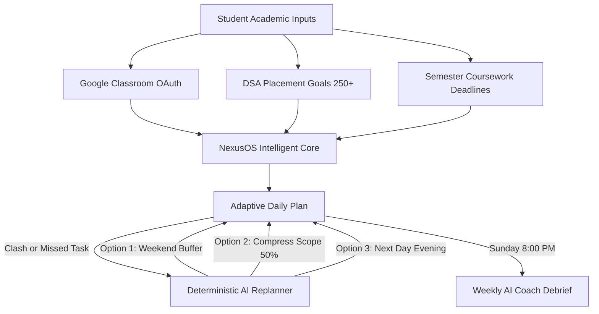
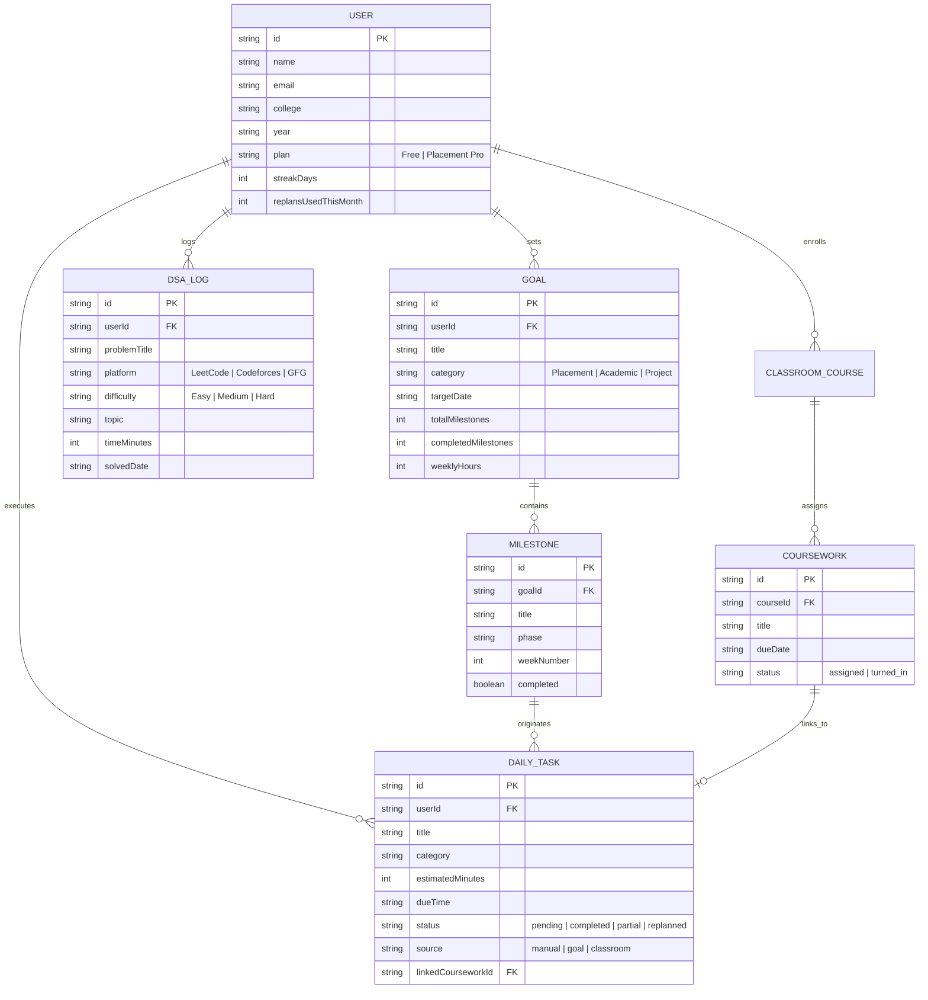

# Product Requirements Document (PRD) — NexusOS
**Product Name:** NexusOS (The AI-Powered Student Operating System)  
**Document Version:** 1.0.0  
**Status:** Approved for Implementation & Production Verification  
**Target Release:** MVP v0.1  
**Target Audience:** Indian Engineering & Computer Science Undergraduates  

---

## 1. Executive Summary & Vision

### 1.1 The Problem
Indian engineering students operate in high-pressure, fragmented environments. An average 2nd- or 3rd-year student preparing for top-tier SDE placements juggles **5 to 6 disconnected tools**:
- **Google Classroom / Moodle:** University assignment submissions and lab reports.
- **LeetCode / GeeksforGeeks / Striver Sheets:** Daily problem solving for placement readiness.
- **Notion / Obsidian:** Unmaintained project roadmaps and study notes.
- **Google Calendar / WhatsApp Groups:** Class timetables and surprise announcement tracking.

When unexpected coursework, surprise vivas, or college fests clash with ambitious study plans, students experience the **"Guilt-Spiral Dropoff"**: missing 1–2 days of a rigid planner results in a backlog of overdue red badges, leading to complete abandonment within 2–3 weeks.

### 1.2 The Solution
**NexusOS** is a unified, intelligent student operating system that combines university coursework ingestion with placement roadmaps, backed by an **Adaptive AI Replanner**. Instead of shaming students with overdue tasks, NexusOS automatically reschedules delayed work into feasible weekend buffer slots or compresses scope to keep milestone dates and consistency streaks intact.

---

## 2. Target Personas & User Journeys

### 2.1 Primary Persona: Aarav Sharma (The Placement Scribe)
- **Profile:** 3rd Year B.Tech CSE at an Indian engineering institution (NIT/Tier-2 college).
- **Academic Context:** Enrolled in Sem 5 core subjects: Operating Systems, Database Management Systems, Design & Analysis of Algorithms.
- **Aspirations:** Secure a summer SDE internship at a top product tech company (target: ₹1.5L+ stipend or Tier-1 FTE).
- **Core Targets:** Solve 250+ LeetCode problems, complete 1 multimodal full-stack project, maintain $\ge 8.5$ CGPA.
- **Key Pain Point:** Surprise lab assignments (e.g. OS CPU scheduling simulation due in 24 hours) destroy his 2-hour daily DSA block. Manual replanning creates fatigue, causing him to break his study streak.

### 2.2 Secondary Persona: Priya Patel (The Multi-hyphenate Learner)
- **Profile:** 2nd Year B.Tech IT, exploring frontend engineering, hackathons, and foundational algorithms.
- **Aspirations:** Build strong GitHub portfolio projects without letting college attendance and internal tests slide.
- **Key Pain Point:** Difficulty estimating realistic weekly study hours. Juggles club commitments with academic deadlines.

---

## 3. Product Principles

1. **Guilt-Free Planning:** Overdue tasks are treated as scheduling conflicts to be rebalanced, never as moral failures. No red exclamation points or shaming UI.
2. **The 15-Second Daily Loop:** Daily check-ins must be completed in under 15 seconds through three quick-action chips (*"Ho Gaya"*, *"Aadha Hua"*, *"Miss Ho Gaya"*).
3. **Student-Centered Empathy & Hinglish Resonance:** Clear, relatable copy (*"Aaj raat OS lab due hai, isliye DSA evening session buffer mein shift kiya"*).
4. **Deterministic Over Magical:** The AI does not silently overwrite calendars. It presents 3 clear, deterministic proposals and asks for student confirmation.
5. **Zero Friction Day-1 Value:** Read-only Google Classroom connection pulls enrolled courses and deadlines instantly on signup.

---

## 4. Functional Requirements (FR)

### FR-1: Adaptive Daily Plan & Command Center
- **FR-1.1:** System shall compute and display **4 real-time header metrics**:
  - *Consistency Streak:* Consecutive days of logged activity (with flame badge and daily maintenance criteria).
  - *Day Completion Rate:* Real-time percentage of today's planned focus time completed.
  - *Planned Focus Time:* Total hours planned vs. minutes executed today.
  - *Classroom Deadlines:* Count of pending submissions due within the next 48 hours.
- **FR-1.2:** System shall spotlight a **Recommended Next Action** banner identifying the highest-leverage task (e.g. nearest hard deadline).
- **FR-1.3:** Every task shall support a **Tri-State Daily Check-in**:
  - `Ho Gaya` (Complete): 100% time logged, triggers celebratory confetti and streak protection toast.
  - `Aadha Hua` (Partial): Logs 50% duration, marks remainder for reallocation.
  - `Miss Ho Gaya` (Missed): Immediately triggers the AI Replan Modal with task pre-selected.
- **FR-1.4:** Task list filters for *All Tasks*, *Pending*, and *Done*.

### FR-2: Goal & Milestone Roadmap Generator
- **FR-2.1:** Allow students to create multi-week goals across 4 categories: *Placement*, *Academics*, *Project*, *Skill*.
- **FR-2.2:** AI-assisted roadmap decomposition dividing goals into 4–12 week sequential milestone phases (e.g., Arrays & Strings $\rightarrow$ Trees & BST $\rightarrow$ Graphs $\rightarrow$ DP).
- **FR-2.3:** Calculate weekly commitment hours (e.g., 18 hrs/week) to ensure total workload does not exceed student capacity.
- **FR-2.4:** Interactive milestone completion checklists that update overall sprint progression.

### FR-3: Google Classroom Two-Way Synchronization
- **FR-3.1:** Connect via Google OAuth 2.0 with read-only classroom scopes (`classroom.courses.readonly`, `classroom.coursework.me.readonly`).
- **FR-3.2:** Ingest enrolled college courses, active coursework, instructor metadata, and due dates.
- **FR-3.3:** Deduplicate assignments using unique coursework IDs (`source=classroom`).
- **FR-3.4:** Provide a `Turn In & Task Complete` action that marks both the Classroom submission status and completes the corresponding daily study task in NexusOS.
- **FR-3.5:** Fallback import for institutions blocking external OAuth (manual coursework entry and ICS syllabus import).

### FR-4: DSA Placement Mastery Tracker
- **FR-4.1:** Benchmark tracking toward a 250 curated problem target (Striver SDE Sheet / LeetCode Top 150).
- **FR-4.2:** **Daily 2-Problem Quota Bar:** Visual meter indicating daily quota status; satisfying quota protects the active streak.
- **FR-4.3:** **Difficulty Breakdown:** Segmented visualization into Easy, Medium, and Hard problem distributions with target recommendation ($\ge 50\%$ Medium).
- **FR-4.4:** **Topic Saturation Matrix:** Interactive coverage cards across core topics:
  - Arrays & Strings
  - Two Pointers & Sliding Window
  - Trees & Binary Search Trees
  - Graphs (BFS/DFS/Dijkstra)
  - Dynamic Programming
  - Trie & Bit Manipulation
- **FR-4.5:** Modal for logging solved problems with Platform (LeetCode, Codeforces, GFG), difficulty, time spent, and problem link.
- **FR-4.6:** CSV Export and Batch Import capability for migrating existing LeetCode/GFG history.

### FR-5: Deterministic Adaptive Replanner
- **FR-5.1:** Triggerable automatically upon marking a task `Miss Ho Gaya` or manually via the `Replan` button.
- **FR-5.2:** Generates **3 deterministic proposals**:
  - *Option 1 (Recommended):* Shift to weekend morning deep-work buffer slot. Protects burnout and milestone completion date.
  - *Option 2 (Streak Protector):* Compress task scope by 50% (quick practice problem or summary note) to preserve consistency streak.
  - *Option 3 (Evening Catch-up):* Reschedule to next evening post-college classes (7:00 PM).
- **FR-5.3:** AI Coach contextual rationale explaining why the shift was suggested (*"Aaj raat CS301 lab due hai..."*).
- **FR-5.4:** User confirmation required; schedule changes are never applied without student clicking `Accept`.

### FR-6: Sunday AI Coach Weekly Debrief
- **FR-6.1:** Comprehensive 7-day performance audit generated every Sunday evening.
- **FR-6.2:** **Daily Deep Work Bar Chart:** Visual trend of focused study hours per day (Mon–Sun) with hover inspection and peak marathon highlights.
- **FR-6.3:** **Completion Velocity Metric:** Total tasks executed vs. planned, plus tasks safely replanned.
- **FR-6.4:** **AI Coach Synthesis:** Narrative summary detailing pacing, streak health, and burnout warnings.
- **FR-6.5:** **Top Wins vs. Missed Areas:** Categorized breakdown of achievements and slip-ups with actionable adjustments for the following week.

### FR-7: Global Command Palette ($\text{Cmd/Ctrl+K}$)
- **FR-7.1:** Universal hotkey listener (`Cmd+K` on macOS, `Ctrl+K` on Windows/Linux) and search bar trigger.
- **FR-7.2:** Instant fuzzy search across tabs (*Aaj Ka Plan*, *Goals*, *Classroom*, *DSA Tracker*, *Weekly Report*, *PRD Analysis*, *Settings*).
- **FR-7.3:** Quick action dispatchers (*Naya Task Jodein*, *AI Replan Trigger*, *DSA Log*, *Classroom Sync*, *Language Toggle*).
- **FR-7.4:** Full keyboard accessibility (`↑`, `↓`, `Enter`, `Escape`).

### FR-8: User Preferences & Localization
- **FR-8.1:** Student academic profile settings (Name, University, Department, Semester, Internship Target Date).
- **FR-8.2:** Instant UI language toggle between **Hinglish 🇮🇳** (culturally resonant) and **English 🌐**.

---

## 5. Non-Functional Requirements (NFR)

| Area | Requirement Specification |
|---|---|
| **Performance** | Page initial load $\le 1.2\text{s}$ on 4G connections; interactive UI updates $\le 50\text{ms}$; 60fps animations. |
| **Reliability** | Zero data loss on network drops; local storage fallback for offline task check-ins with reconciliation on reconnect. |
| **Security & Privacy** | Google OAuth tokens stored securely; read-only academic scopes; student notes and assignment contents never used for model training. |
| **Accessibility** | Full WCAG 2.1 Level AA compliance; keyboard-navigable modals and command palette; minimum 4.5:1 text contrast. |
| **Scalability** | Deterministic heuristics run client-side; LLM calls capped per tier to protect compute margins. |

---

## 6. Data Models & Entity Relationships

---

## 7. Monetization & Packaging Strategy

NexusOS adopts a **Freemium Tiered Architecture** optimized for college budgets:

| Feature / Limit | Free Starter Tier (₹0) | Placement Pro Tier (₹149/mo) |
|---|:---:|:---:|
| **Active Goal Roadmaps** | Up to 2 concurrent | **Unlimited** concurrent |
| **Adaptive AI Replans** | 5 replans / month | **Uncapped** AI replans |
| **Google Classroom Sync** | Manual / Hourly sync | **Real-time instant sync** |
| **DSA Tracker & CSV Export** | Included | Included + Deep pattern analytics |
| **Weekly Performance Debrief** | Standard report | **AI Coach personalized debrief** |
| **Target Milestone Tracking** | Single target | Multiple simultaneous company deadlines |

---

## 8. Success Metrics & 3-Month MVP KPIs

| Category | Metric | 3-Month Target | Rationalization |
|---|---|:---:|---|
| **Activation** | Goal Setup + 1st Task Check-in | $\ge 60\%$ | Confirms immediate user onboarding value. |
| **Retention** | Week-4 Active Retention | $\ge 25\%$ | Benchmark for top student productivity tools. |
| **Engagement** | Weekly Active Check-in Rate | $\ge 3\text{ days/week for } 40\%$ | Verifies adoption into student daily habits. |
| **Integration** | Classroom Connect Rate | $\ge 50\%$ | Demonstrates trust in read-only OAuth. |
| **Product Moat** | AI Replan Acceptance Rate | $\ge 50\%$ | Proves relevance of deterministic proposals. |
| **Monetization** | Free to Pro Conversion | $3\% - 5\%$ | Sustainable unit economics during placement season. |

---

## 9. Risk Matrix & Mitigations

| Risk Description | Severity | Likelihood | Mitigation Strategy |
|---|:---:|:---:|---|
| **Google OAuth Verification Delay** | High | Medium | Provide immediate ICS calendar upload and manual coursework entry as Day-1 fallbacks. |
| **Feature Overload / Cluttered UI** | High | Low | Enforce Bento-box modularity, tabbed views, and 15-second daily check-in workflows. |
| **LLM Token Cost Overruns** | Medium | Medium | Use client-side deterministic scheduling logic; LLM synthesis used only for conversational coaching and weekly debriefs. |
| **College IT Admin Firewall Restrictions** | Medium | High | Support mobile browser access and offline caching via PWA standards. |

---

## 10. Release Scope: V1 vs. Future Roadmap

### In-Scope for V1 (Current Release)
- [x] Adaptive Daily Plan with tri-state check-in (*Ho Gaya*, *Aadha Hua*, *Miss Ho Gaya*).
- [x] Deterministic 3-option AI Replan engine with user confirmation.
- [x] Goals and multi-week milestone sprint generator.
- [x] Google Classroom coursework sync and turn-in linking.
- [x] 250 DSA Placement tracker with topic matrix and CSV import/export.
- [x] Sunday Weekly Debrief with 7-day deep-work bar chart.
- [x] Global Command Palette ($\text{Cmd/Ctrl+K}$).
- [x] Hinglish / English dynamic language switching.
- [x] Firebase authentication and cloud account sync.

### Out of Scope for V1 (Future V2/V3)
- Direct LeetCode GraphQL scraping (pending official API policy).
- WhatsApp daily check-in bot (scheduled for v1.2).
- B2B College Training & Placement (T&P) Officer cohort analytics dashboard (v2.0).
- Peer study groups and collaborative placement sprints (v2.0).

---

*Document approved by NexusOS Product Management & Engineering.*
