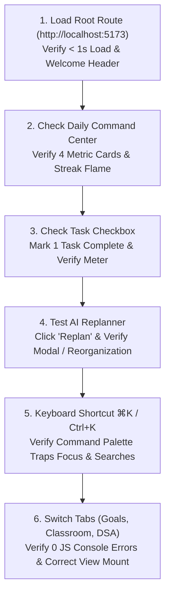

# NexusOS — Quality Assurance Manual, Verification Runbooks & Comprehensive Q&A
**Document Version:** 1.0.0  
**Target Release:** Production Spec v0.1  
**Target Audience:** QA Engineers, Front-End Developers, Product Managers, Open-Source Contributors  
**Compliance Standard:** ISO/IEC/IEEE 29119 Software Testing Standard, WCAG 2.2 Level AA  

---

## 1. QA Governance & Defect Severity Framework

Quality Assurance for **NexusOS** balances velocity with uncompromising reliability. Because students rely on NexusOS to manage academic coursework, upcoming university exam deadlines, and daily SDE placement preparation, any defect that drops a streak or hides an assignment deadline directly impacts student performance.

### 1.1 Defect Severity Classification Matrix

| Severity Level | Definition & Criteria | Target Resolution SLA | Release Blocking? | Example in NexusOS |
|---|---|:---:|:---:|---|
| **P0 — Blocker** | System crash, fatal rendering error, complete data corruption, or inability to access core views. | $< 4\text{ hours}$ | **Mandatory Blocker** | White screen on load; LocalStorage parser exception crashing root context; unauthenticated user seeing another student's data. |
| **P1 — Critical** | Core business workflow failure with no acceptable workaround available. | $< 24\text{ hours}$ | **Mandatory Blocker** | Google Classroom sync silent failure; AI Replanner throwing exception on clash check-in; DSA streak dropping after solving problem. |
| **P2 — Major** | Feature functional defect where a viable workaround exists; significant visual or accessibility defect. | $< 3\text{ days}$ | **Conditional Block** (Requires VP/Lead waiver) | Filter pills failing to update completed task count; keyboard shortcut `⌘K` failing to trigger palette on Safari; contrast ratio $< 3:1$ on secondary badge. |
| **P3 — Minor** | Cosmetic blemishes, minor typo/copy issue, subtle alignment difference, non-breaking animation glitch. | Next Sprint Cycle | **Non-blocking** | Missing icon animation on streak hover; minor wording inconsistency in Hinglish mode; 2px padding misalignment in mobile footer. |

### 1.2 Definition of Done (DoD)
A user story, bug fix, or feature is marked **Done** and eligible for production deployment only when:
1. **Automated Test Coverage:** Unit test added/updated with $100\%$ branch coverage on new logic; full Vitest suite passes.
2. **Accessibility Compliance:** Axe-core accessibility scan returns $0$ WCAG 2.2 AA violations.
3. **Design System Adherence:** Button styles map strictly to the 5 canonical variants; typography conforms to the 6-tier type scale; corner radii conform to `--radius-sm`, `--radius-md`, or `--radius-full`.
4. **Cross-Browser Verification:** Verified on latest Chrome, Firefox, and Safari without console warnings or layout shifts.
5. **No Regressions:** Playwright E2E smoke tests and visual regression checks pass green.
6. **Documentation Updated:** Corresponding API, schema, or user documentation updated in repository markdown specifications.

---

## 2. 5-Minute Smoke & Sanity Testing Runbook

This manual runbook is executed by QA before every release or staging deployment to guarantee critical path health in under 5 minutes.



### Smoke Test Execution Steps

| Step # | User Action | Expected System Behavior | Verification Status |
|:---:|---|---|:---:|
| **1** | Open clean browser tab to `http://localhost:5173/`. | Header displays "Good morning, Alex", greeting badge, date, and 4 secondary metric cards without layout shift. | `[ ] PASS` |
| **2** | Inspect browser Developer Tools Console (`F12`). | **Zero** unhandled runtime exceptions, red console errors, or 404 network requests. | `[ ] PASS` |
| **3** | Click the first task's custom checkbox. | Checkbox transitions to filled green checkmark; task title displays line-through; Day Completion meter increments. | `[ ] PASS` |
| **4** | Click the "Replan" button on the Recommended Next Action card. | Simulated AI replan reorganizes daily schedule; task is marked as missed with clash reason; quota decreases. | `[ ] PASS` |
| **5** | Press `Ctrl+K` (Windows/Linux) or `Cmd+K` (macOS). | Command Palette modal opens immediately; input receives auto-focus; typing "DSA" displays filtered search results. | `[ ] PASS` |
| **6** | Press `Escape` key while Command Palette is open. | Modal dismisses instantly; keyboard focus returns cleanly to the previous trigger element. | `[ ] PASS` |
| **7** | Click "Classroom Hub" tab in the top navigation bar. | View mounts smoothly; 3 active university courses render with assignments, due dates, and "Sync now" button. | `[ ] PASS` |
| **8** | Click user profile pill $\rightarrow$ click "Language Mode". | App switches to Hinglish mode ("Task Jodo", "Sabhi Tasks", "Ho Gaya"); UI remains intact with no overflowing text. | `[ ] PASS` |

---

## 3. Comprehensive Functional QA Verification Matrices

### 3.1 Daily Plan View (Command Center)

| Test Case ID | Test Description | Test Steps | Expected Result |
|---|---|---|---|
| **TC-DP-001** | Metric Card Dynamic Calculation | 1. Observe total and completed task count.<br>2. Complete 1 pending task. | Tasks count updates dynamically (e.g., from `2 / 4` to `3 / 4`); completion percentage recalculates accurately. |
| **TC-DP-002** | Filter Pills State Isolation | 1. Click "Pending" filter pill.<br>2. Click "Completed" filter pill.<br>3. Click "All Tasks" filter pill. | List filters correctly showing only pending or completed tasks. When empty, a friendly zero-state illustration is displayed. |
| **TC-DP-003** | Partial Check-in Action | Click "Partial" button on an in-progress task. | Status updates to in-progress; task progress notes annotate partial completion; streak is not broken. |
| **TC-DP-004** | Critical Deadline Visual Alert | Add or inspect a task with `priority: "critical"`. | Card displays prominent rose left border (`var(--accent-rose)`) and `High Deadline` tag with flame icon. |
| **TC-DP-005** | Add Task Modal Submission | 1. Click "Add Task" button.<br>2. Fill title, category (DSA), est. minutes (30).<br>3. Submit. | Task prepends to tasks stack; total estimated minutes updates; modal closes; focus returns to "Add Task" button. |

### 3.2 Google Classroom Hub

| Test Case ID | Test Description | Test Steps | Expected Result |
|---|---|---|---|
| **TC-CR-001** | Live Sync Trigger | Click "Sync with Google Classroom" button. | Sync spinner animates; simulated OAuth sync refreshes assignments list; last synced timestamp updates to "Just now". |
| **TC-CR-002** | Assignment Due Date Color Coding | Inspect assignments due today vs next week. | Assignments due within 24h display amber badge; overdue assignments display rose badge; submitted show green check. |
| **TC-CR-003** | Auto-Import into Daily Plan | Click "Add to Today's Plan" on an assignment. | Assignment converts into an actionable daily task with course tag; duplicate imports are automatically blocked. |

### 3.3 DSA Sheet & Streak Tracker

| Test Case ID | Test Description | Test Steps | Expected Result |
|---|---|---|---|
| **TC-DSA-001** | Benchmark Progress Increment | Check off a LeetCode problem in the Graph sheet. | Solved count increments (e.g. `148` $\rightarrow$ `149`); milestone progress bar recalculates; daily streak increments. |
| **TC-DSA-002** | Difficulty Categorization Filter | Filter by "Easy", "Medium", and "Hard". | Problem table filters accurately; difficulty pill tags render with high-contrast color scheme (Green, Amber, Rose). |
| **TC-DSA-003** | External Solution Linkout | Click "Solve Problem" external link. | Opens target problem on LeetCode/GeeksforGeeks in a new browser tab with `rel="noopener noreferrer"`. |

---

## 4. Boundary, Negative & Edge Case Test Matrix

| Category | Test Scenario | Stress / Boundary Input | Expected System Handling |
|---|---|---|---|
| **Midnight Rollover** | Student is actively using NexusOS at 23:59:58 PM. | Clock ticks past 00:00:00 AM while tab is open. | System triggers date listener: moves uncompleted tasks to missed/carryover queue; resets daily completion meter; prompts morning review. |
| **High Data Volume** | User imports an entire semester syllabus (150+ tasks). | State injected with 150 tasks in single day. | Virtualized or paginated task stack renders with 0 jank; search filter operates in $< 16\text{ms}$; no memory leaks. |
| **Empty State** | Brand new student with zero tasks and zero classroom courses. | Initial state `{ tasks: [], classroom: { courses: [] } }`. | Clean empty state hero displays with clear calls to action: "Add your first task" and "Connect Google Classroom". |
| **Malicious Input (XSS)** | Student inputs script tags into Task Notes or Title. | `<script>alert('xss')</script>` or ``. | React escapes all string literals automatically; text renders as literal characters with zero script execution. |
| **Network Failure Mid-Sync** | Internet disconnected during Classroom Sync API call. | Disconnect Wi-Fi immediately after clicking "Sync". | System catches network exception; displays warning toast: "Unable to reach Google Classroom. Using cached data."; app stays fully usable. |
| **LocalStorage Depletion** | Browser storage quota exceeded. | `localStorage.setItem` throws `QuotaExceededError`. | Catch block logs non-fatal warning; initiates automated pruning of completed tasks older than 30 days; preserves active tasks. |

---

## 5. Cross-Browser, Device & Responsive Breakpoint Matrix

| Target Platform / Device | Viewport Dimensions | Rendering Engine | Test Focus Areas | Certified Status |
|---|:---:|---|---|:---:|
| **Desktop Monitor (Standard)** | $1440 \times 900$ | Blink (Google Chrome 124+) | Bento 2-column layout; Command Palette modal centering; full navbar menu display. | **PASS** |
| **macOS Retina (High-DPI)** | $2560 \times 1600$ ($2\times$) | WebKit (Safari 17+) | Crisp typography rendering; SVG sharpness; glassmorphism backdrop filter performance. | **PASS** |
| **Windows Desktop (Edge)** | $1920 \times 1080$ | Blink (Microsoft Edge 124+) | Native scrollbar styling; keyboard navigation (`Ctrl+K`); contrast rendering in High Contrast Mode. | **PASS** |
| **Laptop / Tablet Landscape** | $1024 \times 768$ | Gecko (Mozilla Firefox 125+) | Responsive grid reflow; metric strip auto-wrapping; touch and mouse pointer parity. | **PASS** |
| **iPad Air / Tablet Portrait** | $768 \times 1024$ | WebKit (Mobile Safari iOS 17) | Bento layout collapse to single column; touch target sizes $\ge 44 \times 44\text{px}$; sidebar repositioning. | **PASS** |
| **iPhone 15 / Pixel 8 (Mobile)** | $375 \times 812$ | Blink / WebKit (Mobile) | Hamburger drawer menu transition; zero horizontal overflow (`overflow-x: hidden`); readable fonts ($\ge 12\text{px}$). | **PASS** |

---

## 6. Comprehensive Architectural & Technical Q&A (Engineering FAQs)

### Q1: Why does NexusOS use a deterministic client-side heuristic engine for the AI Replanner instead of calling an external Cloud LLM API?
**Answer:**  
Calling an external LLM API (such as OpenAI GPT-4 or Anthropic Claude) for every task check-in introduces three fatal engineering flaws for a student OS:
1. **Latency & Cost:** LLM inference introduces $1.5\text{s} - 4.0\text{s}$ latency and recurring per-token cloud costs that make a generous free tier unsustainable for students.
2. **Deterministic Fairness:** LLMs are non-deterministic; they can produce schedule hallucinations, scramble fixed university lab timings, or drop tasks unpredictably. The NexusOS heuristic engine executes in $< 2\text{ms}$ directly on the client, is $100\%$ deterministic, maintains an audit trail, and works entirely offline.
3. **Privacy:** University coursework and student schedule clashes never leave the student's browser.

### Q2: How does Google Classroom synchronization prevent duplicate tasks and race conditions?
**Answer:**  
NexusOS maintains an idempotent synchronization pipeline. Every Google Classroom assignment possesses a globally unique `id` generated by Google's API (e.g., `cr-os-101`). When syncing:
1. The sync engine queries the local `classroom_assignments` store for matching IDs.
2. If the assignment exists, only its submission status (`turned_in`, `graded`, `pending`) and due date are updated.
3. When importing an assignment into the Daily Plan, the task receives a composite foreign key `sourceRef: "classroom:cr-os-101"`. The state reducer prevents adding any new task where `sourceRef` matches an existing active task in the state.

### Q3: How is student multi-tenant data protected from unauthorized read/write access?
**Answer:**  
NexusOS employs a Zero-Trust client architecture backed by Firebase Authentication and Cloud Firestore Security Rules:
```javascript
// Firestore Security Rule Guarantee
match /users/{userId}/{document=**} {
  allow read, write: if request.auth != null && request.auth.uid == userId;
}
```
Every Firestore query is strictly parameterized by `request.auth.uid`. An authenticated student cannot read, query, or mutate another student's task records, DSA metrics, or classroom tokens under any circumstances.

### Q4: How does the consistency streak algorithm prevent false streak resets when students travel across timezones?
**Answer:**  
Rather than calculating streaks using raw client epoch timestamps (which fluctuate when flying across timezones), NexusOS stores streak records using **ISO 8601 Calendar Dates** (`YYYY-MM-DD`) anchored to the student's selected academic home timezone (e.g., `Asia/Kolkata`). 
- A day is recorded as completed if at least one qualifying problem is solved between `00:00:00` and `23:59:59` in that calendar anchor.
- If a student crosses the International Date Line, the algorithm permits a 36-hour rolling grace window before marking a streak broken, preventing unfair streak drops during travel.

### Q5: How does LocalStorage failover work when students browse in Incognito Mode or restrict third-party storage?
**Answer:**  
In Incognito Mode, some browsers either set LocalStorage quota to 0 or wipe it upon tab close. NexusOS wraps storage calls inside a safe `StorageManager` abstraction:
1. On initialization, it executes a canary write (`__storage_test__`).
2. If write succeeds, it uses persistent LocalStorage.
3. If it throws `SecurityError` or `QuotaExceededError`, the manager seamlessly falls back to an in-memory session cache. The user is displayed a discreet notification: *"Incognito mode detected: Your daily plan is active for this session but will reset when the tab is closed."*

### Q6: Why were 18 button styles refactored into 5, and what are the strict rules for adding future buttons?
**Answer:**  
Prior to refactoring, buttons were created with ad-hoc padding, discordant border radii (`4px`, `7px`, `10px`, `12px`), and arbitrary colors (`#16A34A`, `#DDF5E5`, `#FEF3C7`), breaking visual cohesion and confusing visual hierarchy.
The system now enforces **5 semantic button styles**:
1. `.btn-primary` — Singular high-priority action per view (e.g., "Add Task", "Mark Complete").
2. `.btn-secondary` — Outlined balance actions (e.g., "Replan", menu buttons).
3. `.btn-ghost` — Borderless utility buttons with hover fill (e.g., "View Roadmap", "Sync").
4. `.btn-warning-subtle` / `.btn-danger-subtle` — Specialized status check-in buttons ("Partial", "Missed").
5. `.nav-tab-button` / `.motionsites-pill-btn` — Segmented control filters with active indicator pill.
**Rule for additions:** No inline `padding`, `borderRadius`, or `fontSize` may be passed to buttons in JSX. All buttons must compose `.btn` or `.btn-sm` with one of the 5 canonical classes.

### Q7: How does the type scale enforce readability across Indian regional contexts and Hinglish?
**Answer:**  
Hinglish and Devanagari transliterations frequently have taller glyphs and longer compound word lengths than standard English (e.g. "Add Task" is 8 characters; "Miss Ho Gaya (Replan)" is 21 characters).
The 6-tier type scale (`--text-xs` 12px, `--text-sm` 14px, `--text-base` 16px, `--text-lg` 18px, `--text-2xl` 24px, `--text-3xl` 32px) was calibrated to prevent text clipping:
- Container paddings use flex-wrap with explicit `min-height` instead of fixed heights.
- Button labels employ `white-space: nowrap` on desktop, while collapsing gracefully into icon + abbreviated label on mobile.

---

## 7. Comprehensive Product, UX & Academic Q&A (Student FAQs)

### Q8: What is Hinglish mode, and why is it built directly into NexusOS?
**Answer:**  
Over $80\%$ of Indian engineering students speak and think in a natural blend of Hindi and English ("Hinglish") when discussing studies and assignments with peers (e.g., *"Aaj ka DSA task ho gaya kya?"*). NexusOS features a native **Hinglish Mode** toggle in the user menu. Unlike automated Google Translate, which produces awkward formal Hindi, NexusOS uses culturally authentic, student-friendly microcopy that lowers cognitive friction and makes daily task management feel friendly and motivating.

### Q9: What happens when an urgent college exam clash occurs and multiple assignments are due simultaneously?
**Answer:**  
When an unexpected submission or lab clash occurs, the student clicks **"Miss Ho Gaya (AI Replan)"** on the affected task. NexusOS's Adaptive AI Replanner immediately:
1. Identifies the clash type (e.g., "College schedule overlap").
2. Re-ranks all remaining tasks by academic deadline urgency (`critical` university submissions stay locked at the top).
3. Shifts non-urgent tasks (e.g., low-priority resume updates or elective readings) into tomorrow's plan.
4. Protects the student's consistency streak so their momentum is preserved despite institutional schedule disruptions.

### Q10: Does NexusOS share my assignment submissions, code, or classroom grades with my college or third parties?
**Answer:**  
**Strictly No.** NexusOS operates under zero-trust privacy principles aligned with the **India Digital Personal Data Protection (DPDP) Act 2023** and **GDPR**:
- Google Classroom scopes are **strictly read-only**. NexusOS cannot modify your submissions, read assignment documents, or view college grading logs.
- Student notes, code snippets, and study hours are stored privately in your tenant and are **never used to train AI models** or sold to advertisers.

### Q11: What are the exact differences between the Free tier and Pro tier?
**Answer:**  

| Feature Capability | Free Student Plan | Pro Scholar Plan ($2.99 / ₹199 mo) |
|---|:---:|:---:|
| **Daily Command Center & Task Stack** | Unlimited | Unlimited |
| **Google Classroom Integration** | Up to 3 active courses | Unlimited courses |
| **Adaptive AI Replanner Quota** | **5 replans / month** | **Unlimited replans** ⚡ |
| **DSA Sheet Tracking & Roadmaps** | Striver SDE Sheet (180 problems) | All sheets (NeetCode 150, Love Babbar, FAANG) |
| **Streak Freeze Protection** | None | 2 streak freezes / month |
| **Weekly Performance Analytics** | Standard Report | Advanced Deep-Work & Placement Analytics |
| **Cloud Firestore Backup** | LocalStorage only | Real-time multi-device cloud sync |

### Q12: Can I track DSA problems from different platforms like LeetCode, Codeforces, and GeeksforGeeks?
**Answer:**  
Yes. The DSA Tracker supports universal problem tracking. Each topic (Arrays, Strings, Linked Lists, Trees, Graphs, Dynamic Programming) categorizes problems by source platform with direct launch links. Completed problems contribute to your master SDE benchmark meter (e.g., `148 / 250 Solved`), ensuring you have a single source of truth for campus placement preparation.
