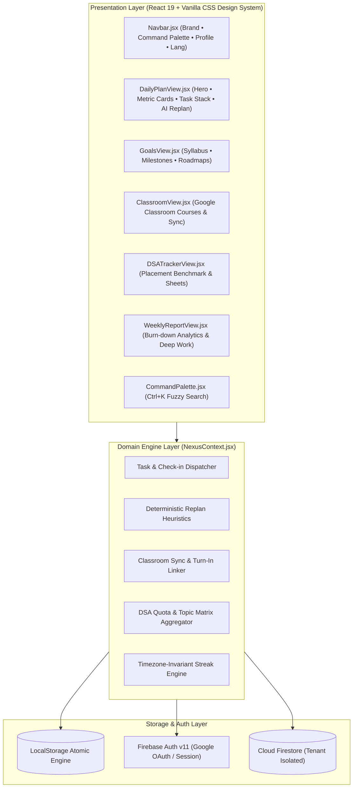

# NexusOS — The AI-Powered Student Operating System

<div align="center">

[](https://opensource.org/licenses/MIT)
[](https://react.dev/)
[](https://vitejs.dev/)
[](https://www.w3.org/WAI/standards-guidelines/wcag/)
[](https://firebase.google.com/)
[](https://playwright.dev/)

**Turn academic chaos into consistent momentum.**  
*An intelligent, offline-first command center for engineering students balancing university assignments, Google Classroom deadlines, and DSA placement prep.*

[Live Demo](http://localhost:5173/) • [Architecture](file:///c:/Users/Asus/OneDrive/NexusOS/ARCHITECTURE.md) • [Product Spec (PRD)](file:///c:/Users/Asus/OneDrive/NexusOS/PRD.md) • [Documentation Index](#-complete-documentation-suite)

</div>

---

## 🌟 Overview & Problem Statement

Engineering students constantly juggle competing priorities: university assignment submissions, surprise lab vivas, attendance minimums, and continuous Data Structures & Algorithms (DSA) preparation for tech placements. Traditional todo apps (Notion, Todoist, Google Calendar) fail because:
1. **They are static:** When a 3-hour surprise college lab schedule clash occurs, the student's daily plan collapses, destroying streak momentum.
2. **They are siloed:** Google Classroom coursework exists in one tab, LeetCode sheets exist in another, and daily tasks exist in a third.
3. **They are cognitively taxing:** Students spend more time organizing tasks than executing deep work.

**NexusOS** solves this with an **Adaptive, AI-Assisted Operating System** that unifies academic deadlines, placement goals, and daily focus blocks into a single reactive command center.

---

## 🚀 Core Features

### 1. ⚡ Adaptive AI Replanner
- **Instant Schedule Recovery:** When college schedules clash or assignments run late, click **"Miss Ho Gaya (AI Replan)"** to immediately re-prioritize remaining tasks.
- **Academic Deadlines Locked:** Critical university submissions stay anchored at the top; lower-priority buffer tasks shift to tomorrow to prevent cognitive fatigue.
- **Deterministic Heuristic Engine:** Runs in $< 2\text{ms}$ locally in the browser with zero cloud LLM latency and 100% offline reliability.

### 2. 📚 Google Classroom Live Hub
- **Direct Coursework Sync:** Sync active enrolled courses and upcoming homework in real-time.
- **Color-Coded Submission Urgency:** Amber badges for assignments due within 24 hours, rose badges for critical submissions, and emerald checkmarks for turned-in work.
- **1-Click Daily Plan Integration:** Convert university assignments into actionable daily focus tasks with pre-populated time estimates and course metadata.

### 3. 🎯 SDE Placement & DSA Tracker
- **Curated Benchmark Sheets:** Track progress through Striver SDE Sheet, NeetCode 150, and topic-wise matrices (Arrays, Graphs, Dynamic Programming).
- **Consistency Streak Engine:** Maintain your daily problem-solving streak with midnight rollover detection and Pro streak freeze protection.
- **Universal Platform Launchers:** Direct deep-links to LeetCode, GeeksforGeeks, and Codeforces problems.

### 4. 🇮🇳 Native Hinglish Microcopy Mode
- Tailored specifically for Indian engineering students who think and converse in a blend of Hindi and English.
- Seamlessly toggle between standard English (*"Add Task"*, *"All Tasks"*, *"Done"*) and natural Hinglish (*"Task Jodo"*, *"Sabhi Tasks"*, *"Ho Gaya"*, *"Aadha Hua"*).

### 5. ⌘K Keyboard Command Palette
- Press `⌘K` (macOS) or `Ctrl+K` (Windows/Linux) to open the modal palette.
- Instantly jump between modules, trigger quick task additions, search coursework, and toggle system preferences without lifting your hands from the keyboard.

---

## 🏗️ System Architecture

NexusOS is built as a single-page reactive application using modern React 19, custom domain engines encapsulated in `NexusContext`, and clean separation of concerns:



---

## 📂 Complete Documentation Suite

NexusOS features an exhaustive, enterprise-grade specification library located in the repository:

| Specification Document | Focus Area & Key Contents |
|---|---|
| [**PRD.md**](file:///c:/Users/Asus/OneDrive/NexusOS/PRD.md) | **Product Requirements Document:** Problem statement, target personas, user journeys, MVP scope, and product metrics. |
| [**DESIGN_UIUX.md**](file:///c:/Users/Asus/OneDrive/NexusOS/DESIGN_UIUX.md) | **Design System & UI/UX Spec:** 6-tier type scale, 3 corner radii tokens, 5 button styles, color tokens, and layout guidelines. |
| [**ARCHITECTURE.md**](file:///c:/Users/Asus/OneDrive/NexusOS/ARCHITECTURE.md) | **Technical Architecture:** State machines, data flow diagrams, component hierarchies, and performance budgets. |
| [**DATABASE.md**](file:///c:/Users/Asus/OneDrive/NexusOS/DATABASE.md) | **Database Schema & Data Dictionary:** LocalStorage atomic schemas, Firestore document models, and indexing strategies. |
| [**SECURITY.md**](file:///c:/Users/Asus/OneDrive/NexusOS/SECURITY.md) | **Security & Authentication Spec:** STRIDE threat model, Zero-Trust client posture, OAuth 2.0, and DPDP Act 2023 compliance. |
| [**FEATURE_DEVELOPMENT.md**](file:///c:/Users/Asus/OneDrive/NexusOS/FEATURE_DEVELOPMENT.md) | **Feature Development Roadmap:** Phase-by-phase timeline, sprint breakdown, and technical dependencies. |
| [**TESTING.md**](file:///c:/Users/Asus/OneDrive/NexusOS/TESTING.md) | **Testing Strategy:** Test Pyramid, Vitest unit tests, Playwright E2E suites, WCAG 2.2 AA gates, and CI/CD workflows. |
| [**QA_DOCUMENTATION.md**](file:///c:/Users/Asus/OneDrive/NexusOS/QA_DOCUMENTATION.md) | **Quality Assurance Manual & FAQs:** 5-minute smoke runbook, edge case matrices, and 12 technical/product FAQs. |
| [**GITIGNORE.md**](file:///c:/Users/Asus/OneDrive/NexusOS/GITIGNORE.md) | **Version Control Exclusion Spec:** Secret shielding, build isolation, OS debris prevention, and Git audit commands. |

---

## 🛠️ Technology Stack

| Layer | Technologies Used | Rationale |
|---|---|---|
| **Core Framework** | React 19, JavaScript (ESM) | High-speed component rendering, zero unnecessary runtime dependencies. |
| **Bundler & Tooling** | Vite 6.0 | Sub-second Hot Module Replacement (HMR) and optimized rollup production bundles. |
| **Design System** | Vanilla CSS Design Tokens | Maximum control, zero Tailwind compilation bloat, strict WCAG 2.2 AA contrast compliance. |
| **Icons & Visuals** | Lucide React | Lightweight, consistent, tree-shakeable SVG icon set. |
| **Backend & Auth** | Firebase Auth v11, Cloud Firestore | Zero-infrastructure serverless identity and multi-tenant document isolation. |
| **Testing** | Vitest, Playwright, axe-core | Full-stack test automation covering Unit, Integration, E2E, and Accessibility. |

---

## ⚡ Quick Start Guide

### Prerequisites
- [Node.js](https://nodejs.org/) version **18.x** or **20.x** (LTS recommended)
- `npm` (v9+) or `pnpm`

### 1. Clone the Repository
```bash
git clone https://github.com/Priyanshuchaudhary-hub/NexusOS.git
cd NexusOS
```

### 2. Install Dependencies
```bash
npm install
```

### 3. Configure Environment Variables
Copy the sample environment file:
```bash
cp .env.example .env
```
*(Optional)* Add your Firebase project credentials to `.env` if enabling live cloud authentication:
```env
VITE_FIREBASE_API_KEY=your_firebase_api_key
VITE_FIREBASE_AUTH_DOMAIN=nexus-os-app.firebaseapp.com
VITE_FIREBASE_PROJECT_ID=nexus-os-app
VITE_FIREBASE_STORAGE_BUCKET=nexus-os-app.appspot.com
VITE_FIREBASE_MESSAGING_SENDER_ID=your_sender_id
VITE_FIREBASE_APP_ID=your_app_id
```
> **Note:** NexusOS functions out-of-the-box in standalone **Guest Demo Mode** with full offline persistence even without Firebase keys!

### 4. Start Development Server
```bash
npm run dev
```
Open your browser at **`http://localhost:5173/`**.

### 5. Build for Production
```bash
npm run build
npm run preview
```

---

## ⌨️ Keyboard Shortcuts

| Shortcut | Action | Description |
|---|---|---|
| `⌘K` or `Ctrl+K` | **Command Palette** | Open search modal to quickly jump to any tab or action. |
| `Escape` | **Dismiss Modal** | Instantly closes any open modal, dialog, or drawer menu. |
| `Tab` / `Shift+Tab` | **Accessible Focus Navigation** | Cycle through interactive buttons and inputs with visible focus rings. |
| `Space` / `Enter` | **Task Check-in** | Toggle task checkbox or trigger button actions. |

---

## 🤝 Contributing

Contributions make the open-source community an incredible place to learn, inspire, and create:

1. **Fork the Project** (`https://github.com/Priyanshuchaudhary-hub/NexusOS/fork`)
2. **Create your Feature Branch** (`git checkout -b feature/AmazingFeature`)
3. **Commit your Changes** (`git commit -m 'feat: add amazing feature'`)
4. **Push to the Branch** (`git push origin feature/AmazingFeature`)
5. **Open a Pull Request**

Please review our [TESTING.md](file:///c:/Users/Asus/OneDrive/NexusOS/TESTING.md) and [QA_DOCUMENTATION.md](file:///c:/Users/Asus/OneDrive/NexusOS/QA_DOCUMENTATION.md) before submitting a PR to ensure all WCAG 2.2 AA and test coverage standards pass.

---

## 📄 License

Distributed under the **MIT License**. See `LICENSE` for more information.

---

<div align="center">
Built with ❤️ for ambitious engineering students everywhere.
</div>
