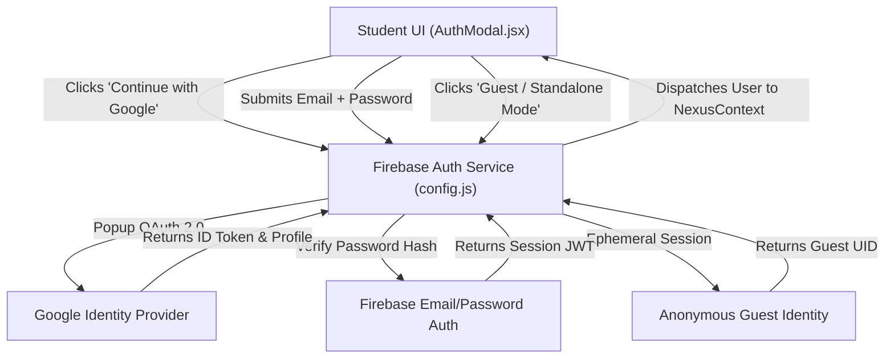
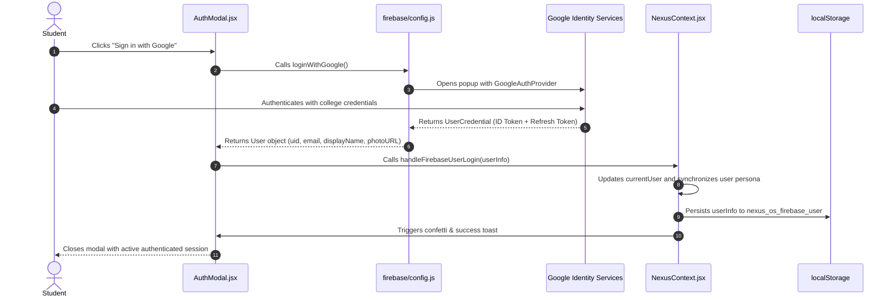
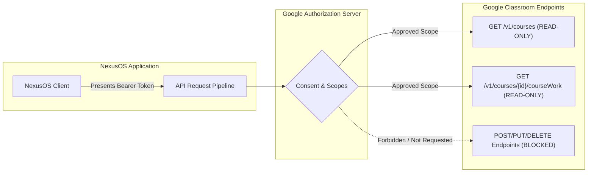

# NexusOS — Authentication & Security Architecture Specification
**Document Version:** 1.0.0  
**Target Release:** Production Spec v0.1  
**Security Standard:** Zero-Trust Client Architecture, OAuth 2.0 / OIDC Compliance, OWASP Top 10 Defenses, India DPDP Act 2023 Alignment  
**Auth Technologies:** Firebase Auth v11, Google Identity Provider, JSON Web Tokens (JWT)  

---

## 1. Executive Summary & Security Posture

**NexusOS** operates on a **Zero-Trust Client Security Posture**. Because the application interfaces with sensitive student data—including university credentials, enrolled Google Classroom coursework, and academic milestone pacing—security and privacy must be foundational, not retrofitted.

### Core Security Guarantees
1. **Principle of Least Privilege:** Google Classroom integration requests strictly **read-only** scopes. NexusOS never requests permission to create, modify, grade, or delete university records.
2. **Zero Code/Notes Scraping:** Student code, notes, and assignment submissions are never ingested, sold, or transmitted to external AI providers for model training.
3. **Graceful Offline Isolation:** The application operates autonomously in guest demo mode without requiring remote credentials or leaking telemetry.
4. **Tenant Data Isolation:** Cloud Firestore data access is cryptographically restricted to the authenticated document owner via Firebase Security Rules.

---

## 2. Threat Modeling (STRIDE Analysis)

A formal threat assessment evaluates potential vectors and countermeasures across the student productivity lifecycle:

| STRIDE Category | Threat Description | Severity | NexusOS Architectural Countermeasure |
|---|---|:---:|---|
| **Spoofing Identity** | Adversary attempts to impersonate student or forge Firebase user session. | High | Google OAuth 2.0 with cryptographically signed RS256 JWT tokens; continuous listener via `onAuthStateChanged()`. |
| **Tampering with Data** | Malicious injection or alteration of task schedules, grades, or DSA logs. | High | Client-side input sanitization; strict Firestore security rules requiring `request.auth.uid == userId`. |
| **Repudiation** | Student claims an AI schedule change was applied without authorization. | Low | Immutable audit trail stored in `replans_history` documenting exact proposal accepted, trigger reason, and timestamp. |
| **Information Disclosure** | Unauthorized extraction of university coursework or internal college marks. | Critical | Strict read-only API scopes; tokens stored in memory/session and never exposed in URL query parameters. |
| **Denial of Service (DoS)** | Script automated rapid replan generation consuming free-tier compute. | Medium | Client-side rate limiting and hard quota cap (5 replans/month on Free tier) before prompting upgrade modal. |
| **Elevation of Privilege** | Free tier student attempts to bypass roadmap limits or access Pro features. | Medium | Invariant checks in state dispatchers (`NexusContext.jsx`) and Firestore security rules validating subscription tier. |

---

## 3. Authentication Architecture (AuthN)

NexusOS supports three authentication modalities managed through [src/firebase/config.js](file:///c:/Users/Asus/OneDrive/NexusOS/src/firebase/config.js) and presented via [src/components/modals/AuthModal.jsx](file:///c:/Users/Asus/OneDrive/NexusOS/src/components/modals/AuthModal.jsx):



### 3.1 Authentication Providers

1. **Google Identity Provider (OAuth 2.0 / OpenID Connect):**
   - Utilizes `GoogleAuthProvider` with interactive pop-up flow (`signInWithPopup`).
   - Automatically populates verified university email (`.edu` or `.ac.in`), display name, and avatar picture.
   - Sets custom OAuth parameter `{ prompt: 'select_account' }` to allow students to switch between personal and college accounts.

2. **Email & Password Authentication:**
   - Employs `signInWithEmailAndPassword` and `createUserWithEmailAndPassword`.
   - Client-side validation enforces minimum 6-character length and valid email regex before network dispatch.
   - Passwords are never stored or logged in client code; Firebase handles Scrypt/Bcrypt hashing server-side.

3. **Anonymous / Guest Demo Mode:**
   - Invokes `signInAnonymously` or uses local mock identity if Firebase environment variables are unconfigured.
   - Stores guest profile in browser `localStorage` (`nexus_os_data`), enabling seamless immediate onboarding without barriers.

### 3.2 Authentication Flow Sequence Diagram



---

## 4. Third-Party Authorization & Google Classroom Scope Governance



### 4.1 Scope Governance Matrix
NexusOS strictly confines Google Classroom permissions to the following read-only scopes:

| Scope URI | Permission Level | Architectural Purpose |
|---|:---:|---|
| `https://www.googleapis.com/auth/classroom.courses.readonly` | Read-Only | Retrieve enrolled university semester subjects, course codes, and faculty instructors. |
| `https://www.googleapis.com/auth/classroom.coursework.me.readonly` | Read-Only | Pull active assignment deadlines, descriptions, and submission statuses. |
| `https://www.googleapis.com/auth/userinfo.email` | Read-Only | Verify college institutional domain (e.g. `@nit.edu.in`). |
| `https://www.googleapis.com/auth/userinfo.profile` | Read-Only | Hydrate display name and avatar in top navigation bar. |

### 4.2 Prohibited Scopes
The following scopes are **explicitly blocked** from the application manifest:
- ❌ `classroom.coursework.students` (No ability to modify submissions on Google servers).
- ❌ `classroom.rosters` (No visibility into classmates' personal data).
- ❌ `classroom.guardianlinks` (No parental access data).

---

## 5. Data Protection & Cryptographic Controls

### 5.1 Transport Security (Data in Transit)
- **HTTPS & TLS 1.3:** All communications with Google Identity APIs, Google Classroom endpoints, and Firebase services are strictly transmitted over **TLS 1.3** with forward secrecy.
- **HSTS Enforcement:** Strict-Transport-Security headers enforce secure transport.

### 5.2 Storage Security (Data at Rest)
- **Cloud Firestore Storage:** Encrypted using **AES-256** at the storage layer by Google Cloud Infrastructure.
- **Local Storage Security:** Local data cached under `nexus_os_data` is sandboxed to the application's origin (`origin = scheme + host + port`). No third-party scripts have access.
- **Token Handling:** Refresh tokens are managed by Firebase SDK using `HttpOnly`, `SameSite=Strict` secure storage where supported.

### 5.3 Student Privacy Boundaries
- **No Model Ingestion:** User-generated study tasks, notes, and DSA code solutions are stored strictly for the student's personal review and are never fed into LLM training corpuses.
- **Data Export & Portability:** Students retain full data ownership and can export their solved DSA problem repository at any time via CSV export.

---

## 6. Multi-Tenant Authorization & Security Rules

To ensure strict tenant isolation in production Firebase deployments, the following rules enforce that authenticated users may only access documents indexed under their own `userId`:

```javascript
rules_version = '2';
service cloud.firestore {
  match /databases/{database}/documents {
    
    // Core helper: Ensures request is from an authenticated user targeting their own document
    function isOwner(userId) {
      return request.auth != null && request.auth.uid == userId;
    }

    // Helper: Validates user plan limits on create/update
    function isValidQuota() {
      return request.resource.data.replansUsedThisMonth <= 5 || 
             request.resource.data.plan == 'Placement Pro';
    }

    // Users Collection Root
    match /users/{userId} {
      allow read: if isOwner(userId);
      allow create: if isOwner(userId) && isValidQuota();
      allow update: if isOwner(userId);
      allow delete: if isOwner(userId);

      // Tasks Subcollection
      match /tasks/{taskId} {
        allow read, write: if isOwner(userId);
      }

      // Goals Subcollection
      match /goals/{goalId} {
        allow read, write: if isOwner(userId);
      }

      // DSA Logs Subcollection
      match /dsa_logs/{logId} {
        allow read, write: if isOwner(userId);
      }

      // Google Classroom Cache Subcollection
      match /classroom/{docId} {
        allow read, write: if isOwner(userId);
      }

      // Replans Audit History Subcollection
      match /replans/{replanId} {
        allow read: if isOwner(userId);
        allow create: if isOwner(userId);
        allow update, delete: if false; // Immutable audit log
      }
    }
  }
}
```

---

## 7. Client-Side Defense-in-Depth

### 7.1 Cross-Site Scripting (XSS) Mitigation
- **JSX Auto-Escaping:** React's Virtual DOM automatically escapes strings rendered in `{}` tags, preventing stored and reflected XSS attacks.
- **Zero `dangerouslySetInnerHTML`:** The codebase completely avoids `dangerouslySetInnerHTML` across all components and views.
- **URL Protocol Validation:** External links (such as LeetCode URLs or Classroom submission links) validate protocols against `http:` and `https:`, blocking `javascript:` pseudo-protocols.

### 7.2 Content Security Policy (CSP) Recommendation
For production hosting, the following CSP headers are recommended:

```http
Content-Security-Policy: 
  default-src 'self';
  script-src 'self' 'unsafe-inline' https://apis.google.com https://*.firebaseio.com;
  style-src 'self' 'unsafe-inline' https://fonts.googleapis.com;
  font-src 'self' https://fonts.gstatic.com;
  img-src 'self' data: https://images.unsplash.com https://*.googleusercontent.com;
  connect-src 'self' https://*.googleapis.com https://*.firebaseio.com https://identitytoolkit.googleapis.com;
  frame-ancestors 'none';
  object-src 'none';
  base-uri 'self';
```

### 7.3 Clickjacking Defense
- Fixed header `X-Frame-Options: DENY` and CSP `frame-ancestors 'none'` prevent NexusOS from being embedded in malicious iframes.

---

## 8. Compliance, Auditability & Incident Response

### 8.1 India Digital Personal Data Protection (DPDP) Act 2023 Alignment
- **Explicit Purpose Specification:** Data collected (enrolled courses, target internship dates) is strictly utilized for academic planning and schedule optimization.
- **Right to Erasure:** Students can reset all local data at any time via **Settings $\rightarrow$ Data & Privacy $\rightarrow$ Reset Data**, which purges `localStorage` and revokes active sessions.
- **Parental/Institutional Autonomy:** No biometric or financial payment credentials are stored locally on student devices.

### 8.2 Audit Trail (`replans_history`)
Every AI-assisted schedule rebalancing is permanently logged in the audit subcollection with:
1. `triggerTask`: The exact task that was delayed.
2. `triggerReason`: Student-supplied justification.
3. `chosenOption`: The resolution option accepted by the student.
4. `date`: Timestamp of the transaction.
This guarantees zero unaccounted calendar changes and complete transparency.

---

*Authored for NexusOS Security Architecture & Engineering Compliance Standards.*
