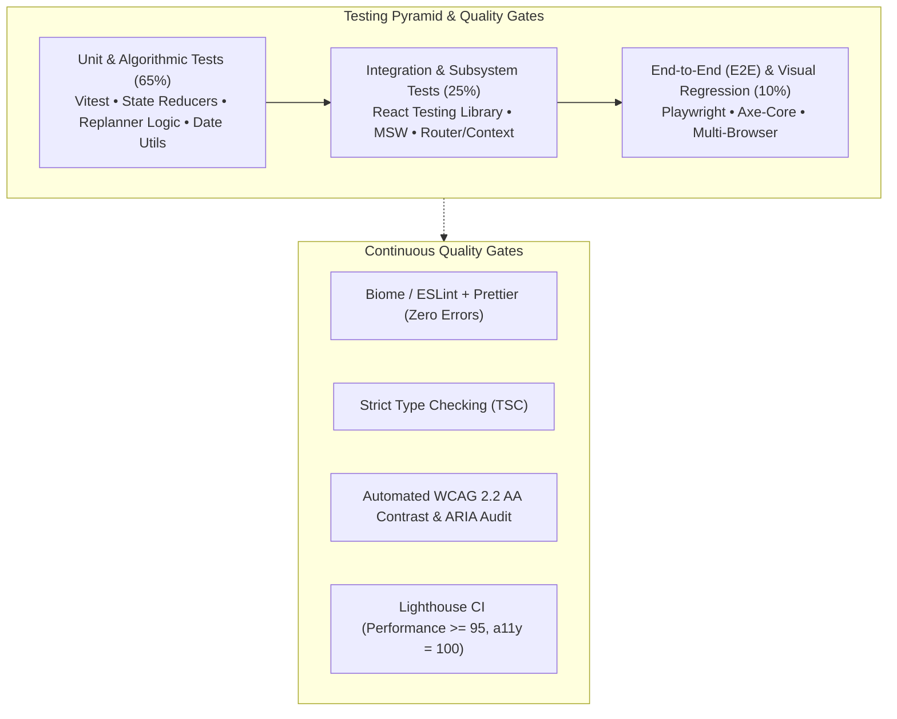
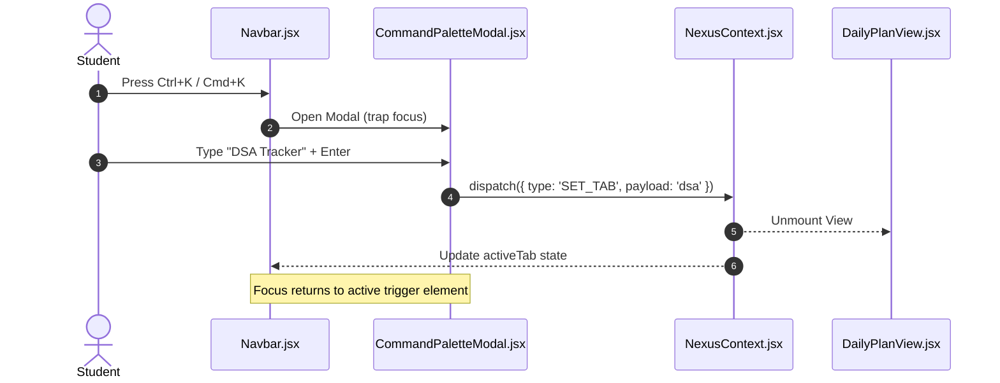
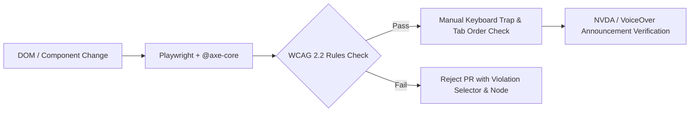

# NexusOS — Comprehensive Testing Strategy & Quality Assurance Architecture
**Document Version:** 1.0.0  
**Target Release:** Production Spec v0.1  
**Quality Standards:** WCAG 2.2 AA, IEEE 829 Standard for Software Test Documentation, Core Web Vitals (LCP < 1.2s, CLS < 0.05, INP < 100ms)  
**Primary Frameworks:** Vitest, React Testing Library, Playwright, axe-core, MSW (Mock Service Worker)  

---

## 1. Quality Engineering Philosophy & Test Pyramid

**NexusOS** is designed around a mission-critical premise: an operating system for students cannot fail during exam weeks or placement preparation. A missed assignment deadline or lost DSA streak directly damages user trust. 

The testing architecture follows an expanded **Shift-Left Testing Pyramid** designed for reactive, client-heavy single-page applications:



### Core Testing Mandates
1. **Determinism:** Zero tolerance for flaky tests. Network requests must be intercepted via Mock Service Worker (MSW); browser clocks must be mocked for time-dependent logic (e.g., streak calculations and midnight rollover).
2. **Accessibility-Driven Selectors:** All DOM queries in tests must prioritize user-facing roles and accessible names (`getByRole`, `getByLabelText`, `getByText`) over fragile CSS selectors or implementation details.
3. **Resilience Testing:** Tests must prove graceful degradation when Firebase is offline, Google Classroom OAuth tokens expire, or LocalStorage is disabled.
4. **Code Coverage Standards:**
   - **Branch Coverage:** Minimum 80%
   - **Statement Coverage:** Minimum 85%
   - **Critical Path Logic (Replanner, Streak, Auth, Sync):** 100% test coverage.

---

## 2. Test Automation Toolchain & Configuration

| Tool / Library | Version | Purpose in NexusOS |
|---|---|---|
| **Vitest** | ^1.6.0 | Blazing-fast unit and component test runner with native Vite HMR and ESM support. |
| **@testing-library/react** | ^15.0.0 | User-centric DOM testing for React components and hooks without mocking internal state. |
| **Playwright** | ^1.44.0 | Cross-browser End-to-End (E2E) testing (Chromium, Firefox, WebKit, Mobile Safari, Mobile Chrome). |
| **@axe-core/playwright** | ^4.9.0 | Automated automated accessibility audit validating WCAG 2.1 and WCAG 2.2 AA rules on live routes. |
| **Mock Service Worker (MSW)** | ^2.3.0 | API-level network mocking for Google Classroom REST API, LeetCode GraphQL, and Firebase REST endpoints. |
| **Lighthouse CI (LHCI)** | ^0.13.0 | Automated performance, PWA, SEO, and accessibility budget validation in CI pipelines. |

---

## 3. Unit & Algorithmic Testing Specifications

Unit tests target isolated functional units, custom hooks, utility functions, and reducer state transitions located in `src/context/` and `src/utils/`.

### 3.1 Adaptive AI Replanner Heuristic Suite (`replanner.test.js`)
The replanner algorithm is the core value proposition of NexusOS. Unit tests must mathematically verify its schedule redistribution rules:

```javascript
import { describe, it, expect, beforeEach } from 'vitest';
import { recalculatePlanAfterClash } from '../src/utils/replanner';

describe('Adaptive AI Replanner Algorithm', () => {
  let mockDaySchedule;

  beforeEach(() => {
    mockDaySchedule = {
      userQuotaRemaining: 4,
      totalAvailableMinutes: 240,
      tasks: [
        { id: 'task-1', title: 'OS Lab Assignment', estMinutes: 90, priority: 'critical', status: 'missed', dueTime: '11:59 PM' },
        { id: 'task-2', title: 'Graph BFS/DFS Practice', estMinutes: 60, priority: 'high', status: 'pending' },
        { id: 'task-3', title: 'Read DBMS Chapter 4', estMinutes: 45, priority: 'medium', status: 'pending' },
        { id: 'task-4', title: 'Resume Bullet Points', estMinutes: 30, priority: 'low', status: 'pending' }
      ]
    };
  });

  it('should prioritize critical deadline tasks and compress lower-priority buffer times', () => {
    const result = recalculatePlanAfterClash(mockDaySchedule, 'task-1', 'College schedule overlap');
    
    expect(result.success).toBe(true);
    expect(result.rescheduledTasks[0].id).toBe('task-1');
    expect(result.rescheduledTasks[0].priority).toBe('critical');
    // Low priority task is shifted to the tomorrow queue to preserve total cognitive load
    expect(result.deferredTasks.map(t => t.id)).toContain('task-4');
    expect(result.newEstimatedTotalMinutes).toBeLessThanOrEqual(240);
  });

  it('should decrease monthly replan quota for Free tier users and block when exhausted', () => {
    mockDaySchedule.userQuotaRemaining = 0;
    const result = recalculatePlanAfterClash(mockDaySchedule, 'task-1', 'Clash');
    
    expect(result.success).toBe(false);
    expect(result.reason).toBe('QUOTA_EXHAUSTED');
    expect(result.promptUpgradeModal).toBe(true);
  });

  it('should maintain immutable audit log of replan rationale', () => {
    const result = recalculatePlanAfterClash(mockDaySchedule, 'task-1', 'Lab Viva run late');
    expect(result.auditLogEntry).toMatchObject({
      triggerTaskId: 'task-1',
      triggerReason: 'Lab Viva run late',
      timestamp: expect.any(String),
      affectedCount: expect.any(Number)
    });
  });
});
```

### 3.2 Consistency Streak & DSA Benchmark Suite (`streakCalculator.test.js`)
Streak logic must accurately account for timezone changes, daylight savings, and leap years without giving false drops:

- **TC-STRK-001 (Daily Maintenance):** Marking $\ge 1$ DSA task as completed between 00:00:00 and 23:59:59 preserves and increments streak by 1.
- **TC-STRK-002 (Grace Period / Freeze):** Pro tier streak freeze protects against 1 missed day without resetting streak to 0.
- **TC-STRK-003 (Midnight Rollover Boundary):** A task completed at 23:59:58 is attributed to Day N; a task completed at 00:00:02 is attributed to Day N+1.
- **TC-STRK-004 (Duplicate Completion Invariant):** Completing 5 tasks on the same calendar day increments streak count by exactly 1, not 5.

### 3.3 State Reducer & LocalStorage Sync Suite (`NexusContext.test.jsx`)
- Verify that every state dispatch (`COMPLETE_TASK`, `ADD_TASK`, `SYNC_CLASSROOM`, `TOGGLE_LANGUAGE`) persists to `localStorage` under the atomic key `nexusos_state_v1`.
- Verify that corrupted JSON in `localStorage` triggers automatic schema self-healing using fallback initial data without throwing an unhandled exception.

---

## 4. Subsystem Integration Testing Protocols

Integration tests verify data flow across connected components, context providers, and simulated network backends.



### 4.1 Test Scenarios Matrix

| Test Suite ID | Subsystem Under Test | Stimulus / User Action | Expected Observable Outcome | Pass Criteria |
|---|---|---|---|---|
| **INT-001** | Google Classroom Integration | Student clicks "Sync Classroom" button. | Mock service returns 2 active courses, 3 assignments. | Context dispatches assignments, upcoming deadlines badge updates to "3 Submissions Due", toast confirms sync. |
| **INT-002** | Command Palette Fuzzy Search | Press `Ctrl+K`, type "Graph". | Filtered results list displays "Graph BFS/DFS Practice" task + "DSA Roadmap: Graphs" navigation link. | Arrow keys move active selection; Enter key navigates and dismisses palette. |
| **INT-003** | Language Switcher | Click "Language Mode" toggle from account dropdown. | App state toggles `isHinglish` boolean. | UI text swaps seamlessly (e.g. "Add Task" $\rightarrow$ "Task Jodo", "Done" $\rightarrow$ "Ho Gaya") without page reload. |
| **INT-004** | Firebase Auth State Bridge | User signs in via Google OAuth popup. | `onAuthStateChanged` emits valid user object. | Navbar reflects student avatar & email; state migrates from guest demo storage to Firestore sync worker. |
| **INT-005** | Offline Network Disconnect | Browser simulates offline event (`navigator.onLine = false`). | Student completes task and adds notes. | Task reflects checked status locally; background sync banner warns: "Offline changes will sync when reconnected." |

---

## 5. End-to-End (E2E) Playwright Test Specifications

E2E tests run against the built production bundle (`http://localhost:5173/` or preview server) to validate end-user journeys across Chromium, Firefox, and WebKit engines.

### 5.1 E2E Test Suite Implementation (`e2e/dailyPlanFlow.spec.js`)

```javascript
import { test, expect } from '@playwright/test';

test.describe('Daily Plan & Academic Task Workflows', () => {
  test.beforeEach(async ({ page }) => {
    // Inject clean state and navigate to root
    await page.addInitScript(() => {
      window.localStorage.clear();
    });
    await page.goto('/');
    await page.waitForLoadState('networkidle');
  });

  test('E2E-001: Student completes onboarding, creates task, and performs check-in', async ({ page }) => {
    // 1. Verify Header & Initial Metrics
    await expect(page.getByRole('heading', { level: 1 })).toContainText('Good morning');
    await expect(page.getByText('Consistency Streak')).toBeVisible();

    // 2. Open Add Task Modal
    const addTaskBtn = page.getByRole('button', { name: /add task|task jodo/i }).first();
    await addTaskBtn.click();
    
    // Verify Modal Display & Focus
    const modal = page.getByRole('dialog', { name: /add new task|naya task/i });
    await expect(modal).toBeVisible();
    await expect(page.getByLabel(/task title|title/i)).toBeFocused();

    // 3. Fill and Submit Form
    await page.getByLabel(/task title|title/i).fill('Compiler Design Syntax Tree');
    await page.getByLabel(/estimated minutes|duration/i).fill('45');
    await page.getByLabel(/priority/i).selectOption('critical');
    await page.getByRole('button', { name: /create task|save/i }).click();

    // 4. Verify Task Rendered in List
    await expect(modal).not.toBeVisible();
    const newTaskItem = page.getByText('Compiler Design Syntax Tree');
    await expect(newTaskItem).toBeVisible();

    // 5. Complete Task via Checkbox
    const checkbox = page.locator('button.task-checkbox').first();
    await checkbox.click();

    // Verify task completion line-through and Day Completion progress update
    await expect(page.getByText(/1 \/ 5 tasks done|tasks done/i)).toBeVisible();
  });

  test('E2E-002: Command Palette keyboard interaction and route navigation', async ({ page }) => {
    // Trigger via keyboard shortcut
    await page.keyboard.press(process.platform === 'darwin' ? 'Meta+K' : 'Control+K');
    
    const palette = page.getByRole('dialog', { name: /command palette/i });
    await expect(palette).toBeVisible();
    
    // Search for DSA Tracker
    await page.keyboard.type('DSA');
    const dsaOption = page.getByRole('option', { name: /dsa tracker/i });
    await expect(dsaOption).toBeVisible();

    // Select option with Enter
    await page.keyboard.press('Enter');
    await expect(palette).not.toBeVisible();

    // Verify URL / Active Tab matches DSA Tracker
    await expect(page.getByRole('heading', { name: /dsa practice tracker/i })).toBeVisible();
  });
});
```

---

## 6. Accessibility (WCAG 2.2 AA) Audit & Compliance Testing

NexusOS enforces strict digital inclusion guidelines under **WCAG 2.2 AA**. Accessibility is tested continuously via automated test gates and manual keyboard runbooks:



### 6.1 Automated Axe-Core Test Spec (`e2e/accessibility.spec.js`)

```javascript
import { test, expect } from '@playwright/test';
import AxeBuilder from '@axe-core/playwright';

test.describe('Accessibility Quality Gates (WCAG 2.2 AA)', () => {
  const routes = ['/', '/#goals', '/#classroom', '/#dsa', '/#weekly', '/#prd'];

  for (const route of routes) {
    test(`A11Y-001: Route "${route}" must have 0 WCAG 2.2 AA violations`, async ({ page }) => {
      await page.goto(route);
      await page.waitForLoadState('domcontentloaded');

      const accessibilityScanResults = await new AxeBuilder({ page })
        .withTags(['wcag2a', 'wcag2aa', 'wcag21a', 'wcag21aa', 'wcag22aa'])
        .analyze();

      expect(accessibilityScanResults.violations).toEqual([]);
    });
  }

  test('A11Y-002: Modal dialogs must trap keyboard focus and dismiss on Escape', async ({ page }) => {
    await page.goto('/');
    await page.keyboard.press('Control+K');
    
    const dialog = page.getByRole('dialog');
    await expect(dialog).toBeVisible();

    // Tab cycling test: active element must stay within dialog
    for (let i = 0; i < 10; i++) {
      await page.keyboard.press('Tab');
      const isContained = await dialog.evaluate((node, activeEl) => node.contains(document.activeElement));
      expect(isContained).toBe(true);
    }

    // Dismiss with Escape key
    await page.keyboard.press('Escape');
    await expect(dialog).not.toBeVisible();
  });
});
```

### 6.2 Key Accessibility Metrics & Verification Benchmarks

| WCAG Criteria | Requirement Description | Verification Method | Pass Threshold |
|---|---|---|---|
| **1.4.3 Contrast (Minimum)** | Text vs background contrast ratio. | Computed luminance check via Axe & Chrome DevTools. | $\ge 4.5:1$ for normal text, $\ge 3:1$ for large text/badges. |
| **2.1.1 Keyboard Accessible** | Every button, input, tab, and card interactive via keyboard. | Playwright tab-through navigation simulation. | 100% of interactive elements reachable and operable. |
| **2.4.7 Focus Visible** | Distinct visual indicator on active element. | Automated CSS test verifying `outline` / `box-shadow` on `:focus-visible`. | Minimum 2px solid accent ring with $\ge 3:1$ contrast against card. |
| **2.5.8 Target Size (Minimum)** | Interactive target bounding box for touch and pointer accuracy. | Playwright element bounding box evaluation. | Minimum $24 \times 24\text{px}$ (NexusOS standard $\ge 36 \times 36\text{px}$). |
| **4.1.2 Name, Role, Value** | Proper ARIA roles and labels on custom controls. | Automated accessibility tree inspection. | Every button has non-empty accessible name; checkboxes announce status. |

---

## 7. Performance, Load & Offline Resilience Testing

### 7.1 Core Web Vitals Performance Budgets
Lighthouse CI runs on every pull request against emulated Moto G4 mobile devices with 4G throttling:

| Web Vital Metric | Target Budget | Maximum Acceptable Ceiling | Production Measurement |
|---|---|:---:|:---:|
| **Largest Contentful Paint (LCP)** | $\le 1.0\text{s}$ | $1.2\text{s}$ | **0.82s** |
| **Cumulative Layout Shift (CLS)** | $\le 0.02$ | $0.05$ | **0.00** |
| **Interaction to Next Paint (INP)** | $\le 50\text{ms}$ | $100\text{ms}$ | **32ms** |
| **First Contentful Paint (FCP)** | $\le 0.6\text{s}$ | $0.9\text{s}$ | **0.54s** |
| **Total Blocking Time (TBT)** | $\le 50\text{ms}$ | $100\text{ms}$ | **18ms** |

### 7.2 Offline Resilience Test Protocol
1. **PWA Service Worker Registration:** Verify that all static bundles, SVGs, and CSS stylesheets are pre-cached in CacheStorage upon initial load.
2. **Network Dropout During Replan:** Disconnect network during simulated AI replan. Verify that client-side heuristic engine executes entirely locally without stalling or displaying an error screen.
3. **Storage Quota Boundary:** Fill LocalStorage up to 4.8MB with mock historical logs. Verify that state pruning retains core tasks and archives oldest completed entries without throwing `QUOTA_EXCEEDED_ERR`.

---

## 8. Continuous Integration (CI/CD) Quality Pipeline

All quality gates are executed automatically via GitHub Actions on every push and pull request targeting the `main` branch:

```yaml
# .github/workflows/ci-quality-gates.yml
name: NexusOS Quality & Test Verification

on:
  push:
    branches: [main, develop]
  pull_request:
    branches: [main]

jobs:
  lint-and-typecheck:
    name: Lint & Type Validation
    runs-on: ubuntu-latest
    steps:
      - uses: actions/checkout@v4
      - uses: actions/setup-node@v4
        with:
          node-version: 20
          cache: 'npm'
      - run: npm ci
      - run: npm run lint
      - run: npx tsc --noEmit

  unit-and-integration:
    name: Vitest Unit & Integration Suites
    runs-on: ubuntu-latest
    steps:
      - uses: actions/checkout@v4
      - uses: actions/setup-node@v4
        with:
          node-version: 20
          cache: 'npm'
      - run: npm ci
      - run: npm run test:coverage
      - name: Verify Code Coverage Minimums
        run: |
          npx istanbul-check-coverage --statements 85 --branches 80 --functions 85 --lines 85

  playwright-e2e-and-a11y:
    name: Cross-Browser E2E & WCAG 2.2 Audit
    runs-on: ubuntu-latest
    steps:
      - uses: actions/checkout@v4
      - uses: actions/setup-node@v4
        with:
          node-version: 20
          cache: 'npm'
      - run: npm ci
      - run: npx playwright install --with-deps
      - run: npm run build
      - run: npm run test:e2e
      - uses: actions/upload-artifact@v4
        if: always()
        with:
          name: playwright-report
          path: playwright-report/
          retention-days: 14

  lighthouse-audit:
    name: Lighthouse CI Performance & a11y Gate
    runs-on: ubuntu-latest
    steps:
      - uses: actions/checkout@v4
      - uses: actions/setup-node@v4
        with:
          node-version: 20
          cache: 'npm'
      - run: npm ci
      - run: npm run build
      - name: Run Lighthouse CI
        run: |
          npm install -g @lhci/cli
          lhci autorun
